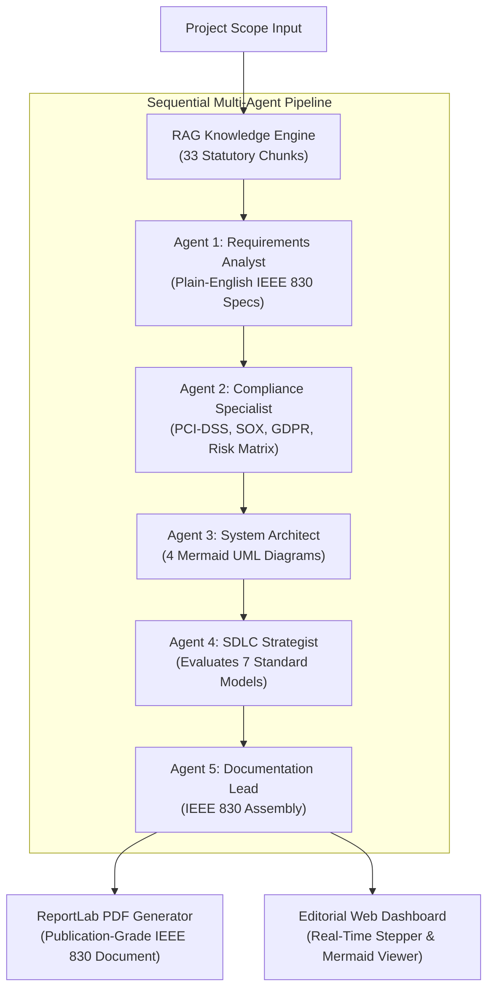

# Agentic-AI System for Requirements Engineering, UML Modeling, and SDLC Selection

An enterprise-grade, multi-agent AI application that automates software requirements engineering, compliance and risk analysis, UML architectural modeling, and SDLC methodology determination for mission-critical software systems.

Built according to:
- **IEEE Std 830-1998 & ISO/IEC/IEEE 29148:2018** (Software Requirements Specifications)
- **PCI-DSS v4.0** (Requirement 3, 8, 10 — Payment & Cardholder Account Data Security)
- **GDPR (EU) 2016/679** (Articles 17, 25, 32 — Privacy by Design & Right to Erasure)
- **Sarbanes-Oxley Act (SOX 404)** (Internal Financial Ledger Controls & Segregation of Duties)
- **Basel III / IV (BCBS 239)** (Operational Risk, Resilience & High Availability)
- **HIPAA Security Rule & HL7 FHIR** (Protected Health Information & Clinical Records)
- **SEC Rule 15c3-5 & FINRA** (Algorithmic Trading Risk Firewalls & Audit Logging)
- **CEN/XFS 3.30 & ISO 8583** (Hardware Electromechanical Drivers & Financial Switching)

---

## Key Features

1. **5 Specialized Collaborative AI Agents**
   - **Agent 1: Requirements Analyst**: Extracts plain-English functional specifications and Given-When-Then acceptance criteria without robotic requirement IDs.
   - **Agent 2: Compliance Specialist**: Cross-references requirements against statutory standards via RAG and formulates an $L \times I$ Risk Register (Likelihood $\times$ Impact).
   - **Agent 3: System Architect**: Synthesizes 4 standard Mermaid.js UML diagrams (Use Case, Domain Class, Transaction Sequence, and State & Activity).
   - **Agent 4: SDLC Strategist**: Evaluates and recommends the single best SDLC methodology among 7 industry models with a 3-point rationale, runner-up, and comparison matrix.
   - **Agent 5: Documentation Lead**: Compiles the official IEEE Std 830 document and generates a publication-grade PDF report.

2. **Domain-Specific RAG Engine**
   - Semantic vector retriever indexing 33 curated statutory and engineering knowledge chunks across banking, healthcare, retail, trading, and methodology selection.
   - Injects authoritative regulatory clauses into prompts to ground generation and prevent hallucinations.

3. **Dynamic 7-Methodology SDLC Decision Engine**
   - Evaluates project constraints against all 7 standard models: **Waterfall, V-Model, Agile/Scrum, Prototyping, RAD, Spiral, and Incremental**.
   - Includes 7 distinct pre-configured benchmark scenarios demonstrating why each model is chosen.

4. **Editorial Web Dashboard**
   - Clean espresso, walnut, and cream aesthetic with serif typography.
   - Real-time active agent activity banner with spinner.
   - Linear 5-agent progression stepper with animated progress bars.
   - Interactive Mermaid.js diagram viewer and single-click official PDF report download.

5. **Dual-Mode Execution Resilience**
   - **Online Mode:** Powered by Google's `gemini-2.0-flash` via the official `google-genai` SDK.
   - **Local Engine Mode:** Built-in deterministic financial domain expert system ensuring zero downtime or crashes even when offline or unauthenticated.

---

## Multi-Agent Architecture



---

## 7 Standard SDLC Benchmark Scenarios

The platform includes 7 pre-configured benchmark scenarios demonstrating the decision criteria across all 7 methodologies:

| Scenario | Domain / System | Recommended Model | Core Decision Rationale |
| :--- | :--- | :--- | :--- |
| **ATM Terminal** | Fleet Firmware & ISO 8583 Switch | **Waterfall Model** | Fixed hardware interfaces (CEN/XFS) and immutable switch protocols; prohibitive defect recall costs mandate linear milestone gates. |
| **Hospital EHR** | Inpatient Records & Clinical Order Entry | **V-Model** | Safety-critical patient care and medication dosage verification; bidirectional traceability required for FDA Class II and HIPAA audits. |
| **Wealth Trading** | Algorithmic Trading & Quantitative Risk Engine | **Spiral Model** | Catastrophic capital exposure; risk-driven spiral cycles with backtesting simulation and kill-switches prior to deploying live capital. |
| **Claims Workbench** | Corporate Claims Adjudication Workbench | **Rapid Application Development (RAD)** | Known internal employees and established business rules; Joint Application Design (JAD) workshops and reusable UI components achieve delivery in 60-90 days. |
| **Biometric Wallet** | Conversational AI & Biometric Mobile Wallet | **Prototyping Model** | High UI/UX ambiguity; disposable voice and facial biometric prototypes resolve usability and acoustic tolerance before backend commitment. |
| **Loan Origination** | Commercial & Retail Underwriting Platform | **Incremental Model** | Phased rollout (Release 1: Intake -> Release 2: Scoring -> Release 3: Underwriting -> Release 4: Disbursement) manages organizational risk and yields early ROI. |
| **Payment Gateway** | Omnichannel Payment Gateway & Merchant Checkout | **Agile / Scrum** | Fast-changing merchant APIs, bi-weekly sprint cadences, and continuous CI/CD automated test suites. |

---

## Repository Structure

```
├── agents/                     # Specialized AI Agents
│   ├── base_agent.py           # Dual-mode base agent (Gemini 2.0 + Expert Fallback)
│   ├── requirements_agent.py   # Agent 1: Plain-English IEEE 830 extraction
│   ├── compliance_risk_agent.py# Agent 2: Regulatory mapping & L x I Risk Register
│   ├── uml_agent.py            # Agent 3: Mermaid.js UML diagram synthesis
│   ├── sdlc_agent.py           # Agent 4: 7-model SDLC evaluation engine
│   └── coordinator_agent.py    # Agent 5: Assembly & verification gate
├── knowledge_base/             # RAG Knowledge Base & Regulatory Data
│   ├── documents/              # 10 authoritative statutory & engineering text sources
│   │   ├── atm_iso8583_hardware_standards.txt
│   │   ├── biometric_conversational_fintech.txt
│   │   ├── pci_dss_v4_controls.txt
│   │   ├── sox_and_gdpr.txt
│   │   ├── aml_and_basel.txt
│   │   ├── healthcare_hipaa_ehr.txt
│   │   ├── investment_wealth_finra_sec.txt
│   │   ├── insurance_claims_standards.txt
│   │   ├── ecommerce_retail_pci.txt
│   │   └── sdlc_methodology_selection_guide.txt
│   └── financial_regulations.py# Regulatory controls catalog & 7 scenarios
├── pipeline/                   # Pipeline Coordination
│   └── orchestrator.py         # Multi-agent sequential pipeline execution
├── rag/                        # Retrieval-Augmented Generation
│   └── retriever.py            # Vector & TF-IDF retriever with cosine similarity
├── reports/                    # Document Rendering
│   └── pdf_generator.py        # ReportLab publication-grade IEEE 830 PDF builder
├── static/                     # Frontend Web Dashboard
│   ├── index.html              # Clean single-screen interface with active stepper
│   ├── style.css               # Editorial warm espresso/cream typography & layout
│   └── app.js                  # Asynchronous pipeline animation & Mermaid rendering
├── training/                   # Model Customization & Fine-Tuning
│   ├── trainer.py              # In-context golden exemplars & enterprise rules
│   └── fine_tune_gemini.py     # Vertex AI / Gemini .jsonl dataset exporter
├── config.py                   # Global system configuration & model parameters
├── main.py                     # Command-line interface (CLI) execution mode
├── server.py                   # FastAPI REST backend server
├── requirements.txt            # Python dependencies
└── output/
    └── TEN_MINUTE_PRESENTATION_GUIDE.md  # Complete 10-minute presentation guide
```

---

## Quickstart Guide

### 1. Prerequisites
- Python 3.10+ (macOS, Linux, or Windows)
- Git

### 2. Clone the Repository
```bash
git clone https://github.com/Veena-nitk/SDLC-.git
cd SDLC-
```

### 3. Set Up Virtual Environment & Dependencies
```bash
python3 -m venv .venv
source .venv/bin/activate

pip install -r requirements.txt
```

### 4. (Optional) Configure Gemini API Key
The system operates with full deterministic capability offline. To enable live inference with Google Gemini 2.0 Flash:
```bash
export GEMINI_API_KEY="your-google-gemini-api-key"
```

### 5. Launch the Web Application
```bash
python server.py
```
Open your browser at **[http://127.0.0.1:8000](http://127.0.0.1:8000)**.

---

## Running via Command Line (CLI)

You can also run the complete multi-agent pipeline from the terminal:

```bash
# Run the default loan origination scenario
python main.py

# Run a specific benchmark scenario (e.g. ATM firmware or hospital EHR)
python main.py --scenario atm_firmware
python main.py --scenario hospital_ehr

# Run with a custom project scope
python main.py --title "Custom Gateway" --scope "Real-time payment routing..."
```

---

## REST API Endpoints

- `POST /api/pipeline/run`: Executes the 5-agent pipeline for a submitted project title and scope.
- `GET /api/scenarios`: Returns the 7 pre-configured benchmark scenarios.
- `GET /api/status`: Returns system readiness, model information, and active RAG metrics.
- `GET /api/download/pdf`: Generates and streams the publication-grade IEEE 830 PDF report.
- `POST /api/rag/query`: Performs ad-hoc semantic queries against the 33 indexed knowledge chunks.

---

## Presentation & Review Resources

A comprehensive 10-minute presentation manual is included in [`output/TEN_MINUTE_PRESENTATION_GUIDE.md`](output/TEN_MINUTE_PRESENTATION_GUIDE.md), featuring:
- 30-Second Elevator Pitch
- 4-Step Backend Architecture Walkthrough
- UI Walkthrough & RAG Explanation
- Minute-by-Minute Speaking Script
- Top 10 Review & Viva Q&A Defense Answers
- Technical Code Tour Cheat Sheet

---

## License

This project is developed for academic research and enterprise software requirements engineering.
Licensed under the Apache 2.0 License.
