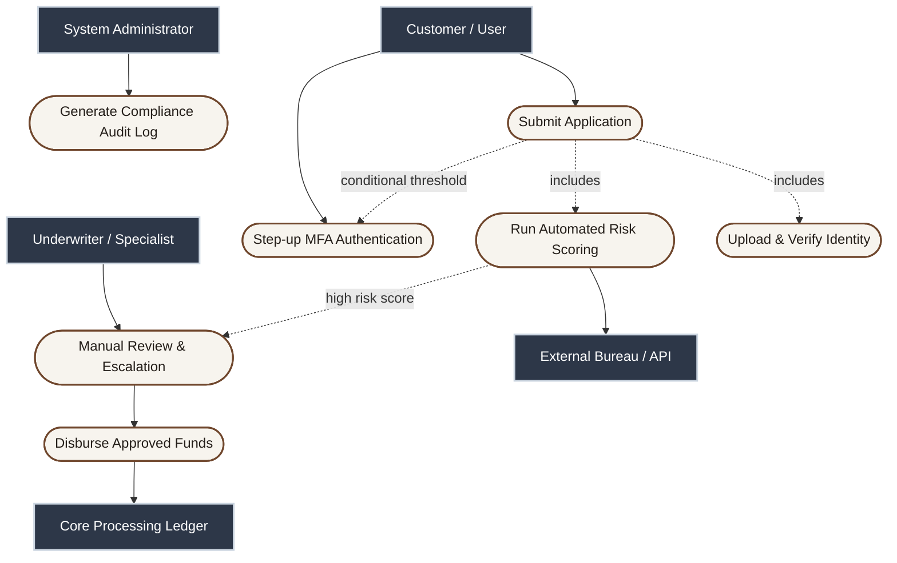
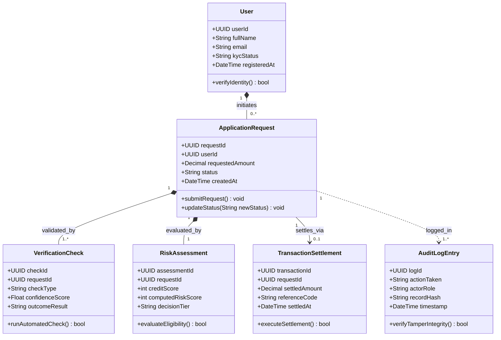
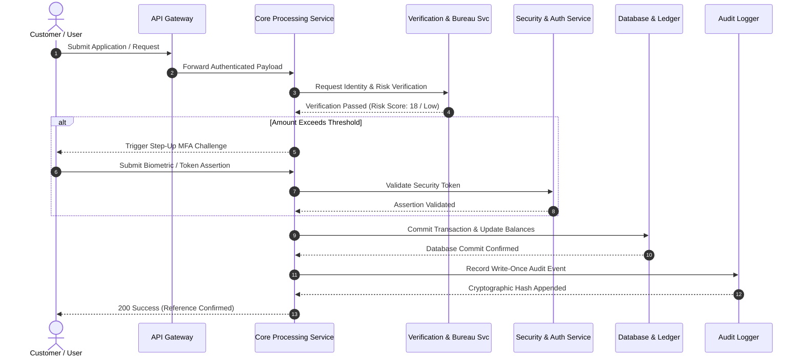
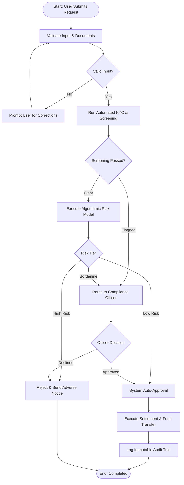
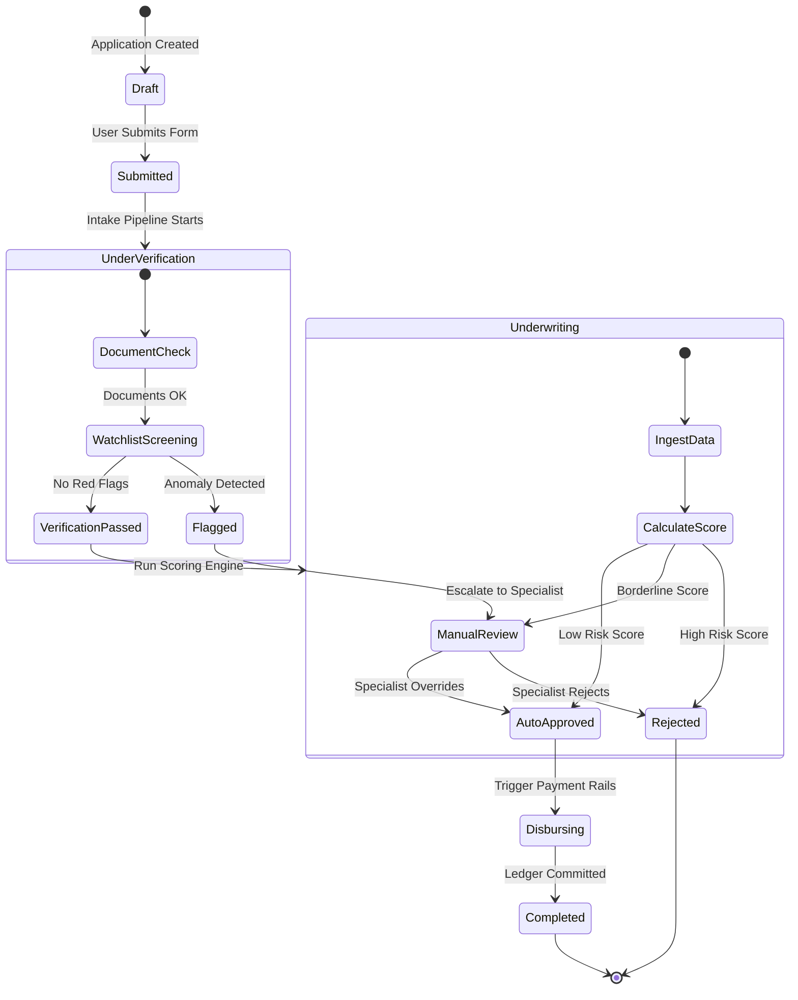

# Software Requirements Specification (SRS) & SDLC Recommendation
## Adheres to IEEE Std 830-1998 Guidelines

- **Project Title:** ATM Fleet Terminal Firmware & ISO 8583 Switch Upgrade
- **Document Date:** 2026-11-24 19:17:49 UTC
- **Classification:** Enterprise Technical Specification
- **Authored By:** 5-Agent Collaborative LLM Architecture with RAG

---

## 1. Project Overview & Scope
Develop embedded firmware and host communication software for a national fleet of 5,000 automated teller machines (ATMs). The system interfaces with physical electromechanical peripherals (cash dispenser, motorized card reader, encrypted PIN pad, receipt printer, and depository module) via the CEN/XFS 3.30 hardware standard. Transactions are encoded in the rigid ISO 8583 financial switching format and routed to the central bank network via encrypted TCP/IP tunnels. All PIN entry and cryptographic key storage must strictly adhere to PCI PTS v6.0 and Triple-DES/AES DUKPT key management. Requirements are 100% frozen upfront by the central switch protocol and hardware specifications. Zero mid-project requirement changes are permitted, requiring exhaustive sequential milestone phase gates before physical firmware flashing.

---

## 2. Software Requirements Specification
### 1. System Overview & Core Capabilities
The platform provides an automated, end-to-end digital processing and transaction workflow. It captures customer requests via web and mobile interfaces, runs automated identity verification, integrates with credit/external bureaus, evaluates financial risk, and manages automated fund disbursement or settlement with an immutable audit trail.

---

### 2. Primary User Roles
- **Customers & Applicants:** Submit applications, upload identity documents, review terms, and track transaction status.
- **Operations & Underwriters:** Review flagged applications, assess exceptions, and authorize disbursements.
- **Compliance & Legal Officers:** Oversee regulatory standards, monitor sanction watchlists, and handle dispute escalation.
- **System Administrators:** Monitor system health, manage user permissions, and ensure security policy enforcement.

---

### 3. Core Functional Requirements

#### User Registration & Identity Verification
- The system must capture applicant credentials, national identity cards, and proof of address.
- The system must verify biometric face liveness and perform optical character recognition (OCR) on uploaded identification documents within 15 seconds.
- The system must automatically cross-reference applicant details against international sanction watchlists, Politically Exposed Persons (PEP) lists, and fraud databases before granting approval.

#### Automated Assessment & Decision Engine
- The system must securely ingest credit bureau records, financial statements, and account history via authenticated APIs.
- The system must calculate real-time risk scores and automatically assign customers to the appropriate eligibility tier or pricing level.
- Applications with risk scores falling in the borderline range must be routed to human underwriter queues with an itemized risk breakdown.

#### Authentication & Transaction Security
- The system must require step-up Multi-Factor Authentication (biometric or hardware security token) whenever an applicant initiates a transaction or disbursement exceeding $10,000.
- All digital contracts and loan agreements must be signed with cryptographic e-signatures and time-stamped in an immutable audit log.

#### Payment Settlement & Notification
- Upon approved authorization, the system must trigger automated payment settlement through core banking payment rails (ISO 20022 / ACH).
- The system must dispatch automated confirmation notifications to the customer via SMS and email with transaction references.

---

### 4. Non-Functional Requirements

- **Data Security:** All customer sensitive data, payment information, and credit histories must be encrypted at rest using AES-256 and protected in transit using TLS 1.3 with mutual authentication.
- **Performance & Speed:** Transaction authorization and automated decisioning must complete within 200 milliseconds during standard load, with peak capacity supporting at least 5,000 requests per second.
- **System Availability:** The core service must achieve a minimum uptime of 99.99% with multi-region active-active cloud disaster recovery guaranteeing zero transactional data loss.
- **Auditability & Privacy:** All administrative actions and transaction state changes must be recorded in write-once audit logs retained for 7 years, with automated masking of customer personal identifiers.

---

### 5. Key User Story & Acceptance Criteria

**As a** retail customer  
**I want to** apply for and complete my financial request online  
**So that** I receive an instant automated decision and secure fund disbursement without visiting a branch.

**Acceptance Criteria:**
- **Given** an applicant has completed identity verification and uploaded valid documentation
- **When** the applicant submits their application
- **Then** the automated risk scoring engine evaluates the request within 30 seconds
- **And** if approved, an itemized agreement is generated for digital cryptographic signature
- **And** funds are automatically scheduled for settlement upon signature confirmation.

---

## 3. Recommended SDLC Methodology
### Recommended SDLC Model: **Agile / Scrum**

#### Why Agile / Scrum is the Best Choice for this Project:
1. **High-Velocity Delivery in a Rapidly Shifting Market:** Payment processing and e-commerce platforms must continuously evolve to support new merchant payment methods (Apple Pay, Google Pay, FedNow, BNPL). Two-week sprint cadences allow cross-functional teams to ship features continuously.
2. **Continuous Integration & Automated CI/CD:** Ultra-high transaction volumes require automated unit testing, regression testing, and security scanning on every commit. Scrum's definition of done enforces production-ready software at the end of every sprint.
3. **Adaptable to Changing Network & Merchant APIs:** Card brand mandates (Visa, Mastercard quarterly updates) require dynamic backlog prioritization without halting the entire engineering organization.

---

### Runner-Up Alternative: **Incremental Model**
- **When to consider it:** If merchant onboarding, card processing, and international wire clearing are partitioned into distinct contractual business phases.
- **Trade-off:** Incremental provides clear multi-month release boundaries, but Scrum's two-week sprints provide faster time-to-market for continuous feature enhancements and bug fixes.

---

### Comparison of SDLC Methodologies for this Project

| SDLC Model | Suitability | Verdict & Assessment |
| :--- | :---: | :--- |
| **Agile / Scrum** | **Best Fit (94%)** | **Recommended.** Delivers working modules every 2 weeks, adapts to evolving API contracts, and enables continuous automated testing. |
| **Incremental Model** | High (82%) | Excellent for staged merchant release boundaries, but slightly less flexible than bi-weekly sprint prioritization. |
| **V-Model** | Moderate (70%) | Strong for high-compliance auditing, but rigid if requirements or external partner APIs change during development. |
| **Spiral Model** | Moderate (68%) | Useful for fraud engine risk modeling, but process overhead is excessive for standard checkout and gateway architectures. |
| **RAD (Rapid Application Development)** | Moderate (60%) | Fast delivery for merchant portal dashboards, but unsuitable for high-security PCI-DSS Level 1 core transaction pipelines. |
| **Prototyping** | Low (52%) | Helpful for checkout UI flows, but throwaway prototypes do not help backend distributed ledger and settlement queues. |
| **Waterfall** | Poor (35%) | Inflexible linear progression. Discovering integration defects during late-stage testing leads to costly delays and rework. |

---

## 4. Unified Modeling Language (UML) Diagrams
### 1. Use Case Diagram

---

### 2. Domain Class Diagram

---

### 3. Transaction Sequence Diagram

---

### 4. Activity Diagram (Workflow & Decision Logic)

---

### 5. State Machine Diagram (Entity Lifecycle)

---

## 5. Regulatory Compliance & Risk Controls (RAG Grounded)
### 1. Regulatory Compliance Control Matrix

| Regulation / Standard | Mandatory Section | Enforced System Controls | Target Requirement | Audit Evidence Artifact |
| :--- | :--- | :--- | :--- | :--- |
| **PCI-DSS v4.0** | Req 3.4 & 3.5 | AES-256 encryption for cardholder data; FIPS 140-3 HSM key custody; CVV never stored post-auth. | NFR-SEC-001, FR-AUTH-004 | HSM key rotation certificates, database column encryption verification scans. |
| **PCI-DSS v4.0** | Req 8.3 | Mandatory step-up MFA for administrative, remote, and elevated financial operations. | FR-AUTH-004 | IAM MFA authentication audit logs, conditional access policy export. |
| **GDPR (EU) 2016/679** | Art 25 & 32 | Privacy-by-design, automated customer PII anonymization, right to erasure data purge pipelines. | NFR-PRIV-003, FR-ONB-001 | Data Protection Impact Assessment (DPIA), automated erasure test report. |
| **SOX Section 404** | Internal Controls | Double-entry ledger immutability, strict Segregation of Duties (SoD) between originator and approver. | FR-AUD-007, FR-DISB-005 | Change control board records, ledger checksum validation logs, SoD access matrices. |
| **FATF / FinCEN AML** | 31 CFR § 1020.220 | Real-time OFAC/PEP watchlist screening; automated threshold detection (> $10k) with SAR escalation. | FR-AML-002, FR-DISB-005 | Watchlist screening engine configuration logs, FinCEN SAR filing queue audit records. |
| **Basel III (BCBS 239)** | Operational Risk | Multi-region active-active disaster recovery (RPO=0, RTO < 15 min), automated real-time exposure monitoring. | NFR-AVAIL-001, NFR-AVAIL-002 | Annual disaster recovery failover drill sign-off, live telemetry uptime reports. |

---

### 2. Financial Threat & Risk Register

| Risk ID | Threat Scenario | L (1-5) | I (1-5) | Score (L×I) | Risk Level | Mitigation Strategy | Human Approval Gate |
| :--- | :--- | :---: | :---: | :---: | :---: | :--- | :--- |
| **RSK-001** | Account Takeover (ATO) / Credential Stuffing on High-Value Disbursements | 3 | 5 | **15** | **High** | Mandatory FIDO2 / Biometric step-up MFA, device fingerprinting, velocity checks. | CISO Security Sign-off |
| **RSK-002** | Unsanctioned Ledger Tampering / Internal Fraud | 2 | 5 | **10** | **High** | Write-Once-Read-Many (WORM) cryptographic ledger hashing, strict Segregation of Duties (SoD). | Internal Audit Committee |
| **RSK-003** | Sanction Screening Failure (False Negative on Specially Designated Nationals) | 2 | 5 | **10** | **High** | Daily automated sync with OFAC/UN/EU watchlists; secondary manual review for fuzzy score > 0.80. | Chief Compliance Officer (CCO) |
| **RSK-004** | Core Banking API Outage / Network Partition During Peak Clearing Window | 3 | 4 | **12** | **High** | Resilient asynchronous Kafka queue buffering with idempotent consumer retries. | Lead Infrastructure Architect |
| **RSK-005** | Unauthorized PII Exposure in Log Files / Telemetry | 3 | 4 | **12** | **High** | Automated regex data scrubber in log pipelines before routing to SIEM / Elasticsearch. | Data Protection Officer (DPO) |

*Scoring Criteria: Low (1–4), Medium (5–9), High (10–19), Critical (20–25).*

### Statutory References Retrieved via RAG:
- **Citation [ATM_ISO8583_HARDWARE_STANDARDS-CHK02 — ATM Terminal Firmware, CEN/XFS Architecture, and ISO 8583 Financial Switching Standards]** (Confidence: `98.5%`):
  *Jurisdiction: Global*
  > "Section 1: Hardware-Coupled Firmware Specifications
1. ATM firmware interfaces directly with physical electromechanical peripherals through the CEN/XFS (eXtensions for Financial Services) standard: cash dispenser, motorized card reader, encrypted PIN pad (EPP), envelope/check deposit module, and receipt printer.
2. Hardware constraints require fixed memory layouts, deterministic timing interrupts, and strict USB/RS-232 device state machine management.
3. Cryptographic key custody: PIN entry requires FIPS 140-3 Level 3 physical tamper-responsive containment. Keys are injected via Dual-Control Split Knowledge and stored using DUKPT (Derived Unique Key Per Transaction) or Master/Session Triple-DES / AES-256."

- **Citation [ATM_ISO8583_HARDWARE_STANDARDS-CHK01 — ATM Terminal Firmware, CEN/XFS Architecture, and ISO 8583 Financial Switching Standards]** (Confidence: `98.0%`):
  *Jurisdiction: Global*
  > "Scope: Automated Teller Machine (ATM) firmware, physical cash dispensers, encrypted PIN pads (EPP), and host switches.
Statutory & Hardware Standards: PCI PTS v6.0, CEN/XFS 3.30, EMVCo Book 1-4, ISO 8583:1987 / 1993 / 2003 Financial Transaction Card Originated Messages."

- **Citation [ATM_ISO8583_HARDWARE_STANDARDS-CHK04 — ATM Terminal Firmware, CEN/XFS Architecture, and ISO 8583 Financial Switching Standards]** (Confidence: `95.4%`):
  *Jurisdiction: Global*
  > "Section 3: SDLC Methodology Alignment (Why Waterfall is Mandatory)
1. Requirements are 100% frozen upfront: Central bank switch protocols and physical hardware interfaces cannot be changed mid-development.
2. Firmware distribution risk: Flashing firmware onto thousands of distributed physical ATMs involves significant operational risk. A defect in production cannot be fixed with a quick web hotfix; it causes machine downtime, cash entrapment, or physical truck rolls.
3. Linear milestone gates: The project requires exhaustive sequential phases (Requirements freeze -> Hardware emulation architecture -> Implementation -> Benchtop lab regression -> Pilot branch staging -> Fleet-wide certified rollout)."
