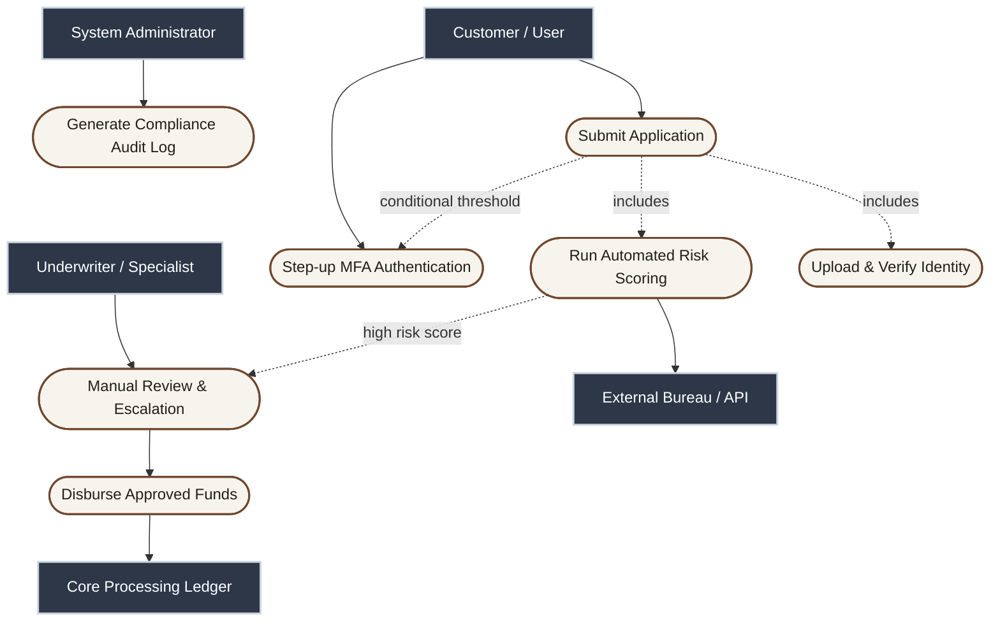
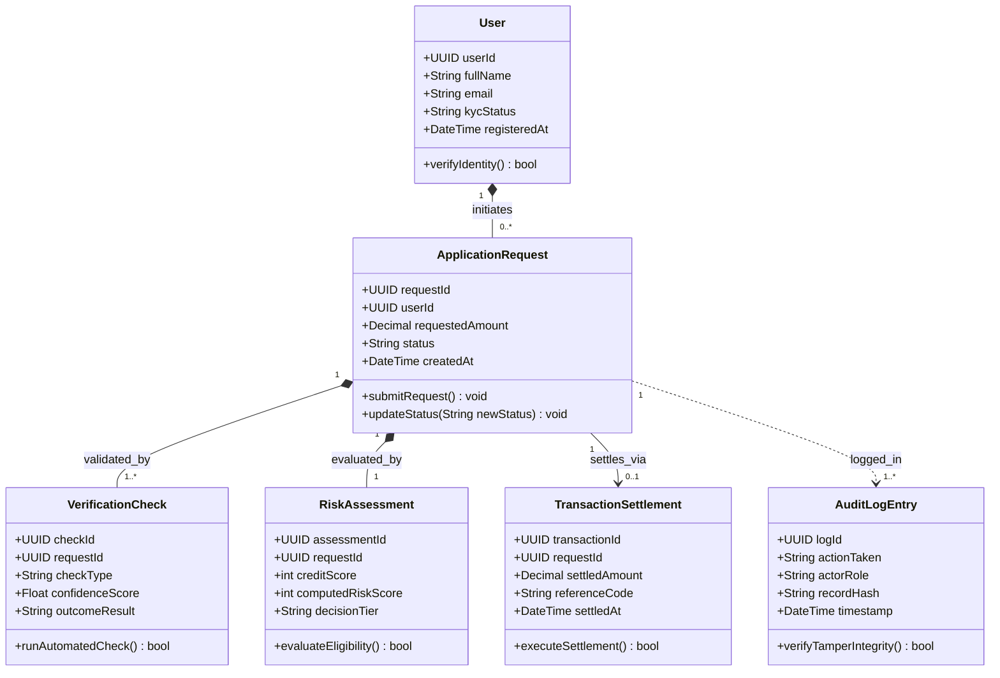
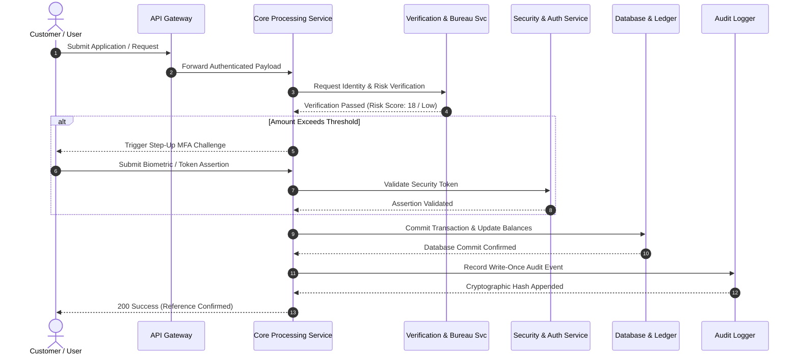
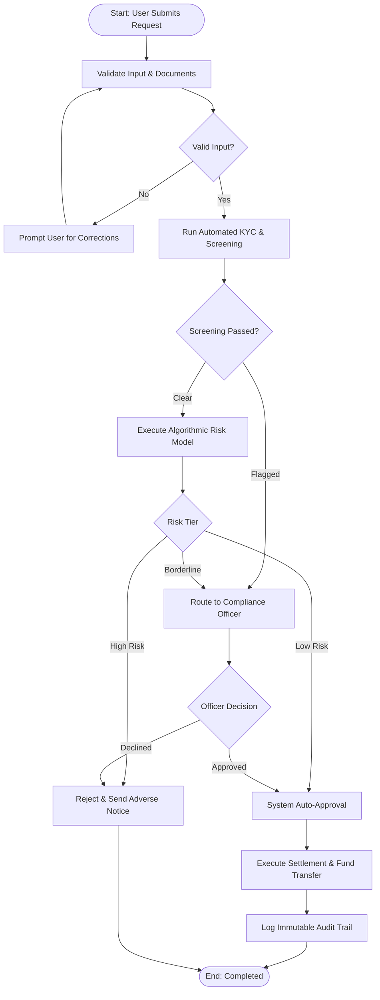
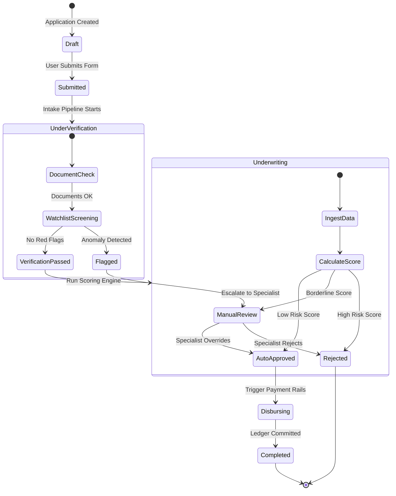

# Software Requirements Specification (SRS) & SDLC Recommendation
## Adheres to IEEE Std 830-1998 Guidelines

- **Project Title:** Automated Loan Origination & Credit Assessment Platform
- **Document Date:** 2026-11-24 19:17:35 UTC
- **Classification:** Enterprise Technical Specification
- **Authored By:** 5-Agent Collaborative LLM Architecture with RAG

---

## 1. Project Overview & Scope
Develop an enterprise digital loan origination and underwriting system for a commercial bank. The platform must intake retail and SME loan applications via web and mobile, perform automated KYC/AML verification, integrate with credit bureaus (Experian, TransUnion) via secure APIs, run an automated risk scoring engine, support underwriter review and escalation for high-value loans (> $250,000), execute digital loan contract signing with cryptographic audit trails, and disburse approved funds to core banking via ISO 20022 messaging. Must comply with SOX 404 accounting controls, GDPR privacy, FCRA fairness, and maintain 99.99% availability.

---

## 2. Software Requirements Specification
### 1. System Overview & Core Capabilities
The platform provides an automated, end-to-end digital processing and transaction workflow. It captures customer requests via web and mobile interfaces, runs automated identity verification, integrates with credit/external bureaus, evaluates financial risk, and manages automated fund disbursement or settlement with an immutable audit trail.

---

### 2. Primary User Roles
- **Customers & Applicants:** Submit applications, upload identity documents, review terms, and track transaction status.
- **Operations & Underwriters:** Review flagged applications, assess exceptions, and authorize disbursements.
- **Compliance & Legal Officers:** Oversee regulatory standards, monitor sanction watchlists, and handle dispute escalation.
- **System Administrators:** Monitor system health, manage user permissions, and ensure security policy enforcement.

---

### 3. Core Functional Requirements

#### User Registration & Identity Verification
- The system must capture applicant credentials, national identity cards, and proof of address.
- The system must verify biometric face liveness and perform optical character recognition (OCR) on uploaded identification documents within 15 seconds.
- The system must automatically cross-reference applicant details against international sanction watchlists, Politically Exposed Persons (PEP) lists, and fraud databases before granting approval.

#### Automated Assessment & Decision Engine
- The system must securely ingest credit bureau records, financial statements, and account history via authenticated APIs.
- The system must calculate real-time risk scores and automatically assign customers to the appropriate eligibility tier or pricing level.
- Applications with risk scores falling in the borderline range must be routed to human underwriter queues with an itemized risk breakdown.

#### Authentication & Transaction Security
- The system must require step-up Multi-Factor Authentication (biometric or hardware security token) whenever an applicant initiates a transaction or disbursement exceeding $10,000.
- All digital contracts and loan agreements must be signed with cryptographic e-signatures and time-stamped in an immutable audit log.

#### Payment Settlement & Notification
- Upon approved authorization, the system must trigger automated payment settlement through core banking payment rails (ISO 20022 / ACH).
- The system must dispatch automated confirmation notifications to the customer via SMS and email with transaction references.

---

### 4. Non-Functional Requirements

- **Data Security:** All customer sensitive data, payment information, and credit histories must be encrypted at rest using AES-256 and protected in transit using TLS 1.3 with mutual authentication.
- **Performance & Speed:** Transaction authorization and automated decisioning must complete within 200 milliseconds during standard load, with peak capacity supporting at least 5,000 requests per second.
- **System Availability:** The core service must achieve a minimum uptime of 99.99% with multi-region active-active cloud disaster recovery guaranteeing zero transactional data loss.
- **Auditability & Privacy:** All administrative actions and transaction state changes must be recorded in write-once audit logs retained for 7 years, with automated masking of customer personal identifiers.

---

### 5. Key User Story & Acceptance Criteria

**As a** retail customer  
**I want to** apply for and complete my financial request online  
**So that** I receive an instant automated decision and secure fund disbursement without visiting a branch.

**Acceptance Criteria:**
- **Given** an applicant has completed identity verification and uploaded valid documentation
- **When** the applicant submits their application
- **Then** the automated risk scoring engine evaluates the request within 30 seconds
- **And** if approved, an itemized agreement is generated for digital cryptographic signature
- **And** funds are automatically scheduled for settlement upon signature confirmation.

---

## 3. Recommended SDLC Methodology
### Recommended SDLC Model: **Incremental Model**

#### Why Incremental Model is the Best Choice for this Project:
1. **Staged Risk Mitigation & Phased Production Rollout:** Enterprise commercial and retail loan platforms involve massive organizational change. The Incremental model allows the bank to deliver Release 1 (Core Retail Intake), followed by Release 2 (Automated Credit Scoring), Release 3 (SME Underwriting Queues), and Release 4 (Core Banking Disbursement).
2. **Operational Training & Manageable Organizational Bandwidth:** Underwriters, compliance officers, and branch loan officers cannot absorb a massive, monolithic platform all at once. Delivering self-contained operational increments allows staff to master one module before the next is deployed.
3. **Early Value Realization & Revenue Generation:** The bank begins capturing loan applications, verifying credit, and generating interest revenue from the very first increment, rather than waiting 12 to 18 months for a monolithic system delivery.

---

### Runner-Up Alternative: **V-Model (Verification & Validation)**
- **When to consider it:** If banking regulators demand that all lending algorithms and underwriter escalation workflows be fully certified under a single formal verification matrix prior to any customer intake.
- **Trade-off:** The V-Model provides great regulatory documentation, but delaying customer launch until every advanced SME underwriting module is built severely delays return on investment and market competitiveness.

---

### Comparison of SDLC Methodologies for this Project

| SDLC Model | Suitability | Verdict & Assessment |
| :--- | :---: | :--- |
| **Incremental Model** | **Best Fit (93%)** | **Recommended.** Phased functional rollouts (Retail Intake -> Scoring -> SME Underwriting -> Core Disbursement) maximize ROI and manage risk. |
| **Agile / Scrum** | High (82%) | Strong for sprint execution within each increment, but executive banking governance requires clearly defined release increments. |
| **V-Model** | High (80%) | Strong compliance verification, but monolithic all-or-nothing release delays initial commercial loan revenue. |
| **Spiral Model** | Moderate (70%) | Useful for credit scoring algorithmic risk, but process overhead is excessive for standard loan application workflows. |
| **RAD (Rapid Application Development)** | Moderate (62%) | Good for underwriter intake forms, but cannot handle complex multi-tier asynchronous credit bureau and core banking integrations. |
| **Prototyping** | Low (50%) | Helpful for loan applicant portal UX, but adds unnecessary throwaway overhead for backend underwriting engines. |
| **Waterfall** | Low (40%) | Highly inflexible. If credit bureau API formats or lending regulations shift during development, the entire project stalls. |

---

## 4. Unified Modeling Language (UML) Diagrams
### 1. Use Case Diagram

---

### 2. Domain Class Diagram

---

### 3. Transaction Sequence Diagram

---

### 4. Activity Diagram (Workflow & Decision Logic)

---

### 5. State Machine Diagram (Entity Lifecycle)

---

## 5. Regulatory Compliance & Risk Controls (RAG Grounded)
### 1. Regulatory Compliance Control Matrix

| Regulation / Standard | Mandatory Section | Enforced System Controls | Target Requirement | Audit Evidence Artifact |
| :--- | :--- | :--- | :--- | :--- |
| **PCI-DSS v4.0** | Req 3.4 & 3.5 | AES-256 encryption for cardholder data; FIPS 140-3 HSM key custody; CVV never stored post-auth. | NFR-SEC-001, FR-AUTH-004 | HSM key rotation certificates, database column encryption verification scans. |
| **PCI-DSS v4.0** | Req 8.3 | Mandatory step-up MFA for administrative, remote, and elevated financial operations. | FR-AUTH-004 | IAM MFA authentication audit logs, conditional access policy export. |
| **GDPR (EU) 2016/679** | Art 25 & 32 | Privacy-by-design, automated customer PII anonymization, right to erasure data purge pipelines. | NFR-PRIV-003, FR-ONB-001 | Data Protection Impact Assessment (DPIA), automated erasure test report. |
| **SOX Section 404** | Internal Controls | Double-entry ledger immutability, strict Segregation of Duties (SoD) between originator and approver. | FR-AUD-007, FR-DISB-005 | Change control board records, ledger checksum validation logs, SoD access matrices. |
| **FATF / FinCEN AML** | 31 CFR § 1020.220 | Real-time OFAC/PEP watchlist screening; automated threshold detection (> $10k) with SAR escalation. | FR-AML-002, FR-DISB-005 | Watchlist screening engine configuration logs, FinCEN SAR filing queue audit records. |
| **Basel III (BCBS 239)** | Operational Risk | Multi-region active-active disaster recovery (RPO=0, RTO < 15 min), automated real-time exposure monitoring. | NFR-AVAIL-001, NFR-AVAIL-002 | Annual disaster recovery failover drill sign-off, live telemetry uptime reports. |

---

### 2. Financial Threat & Risk Register

| Risk ID | Threat Scenario | L (1-5) | I (1-5) | Score (L×I) | Risk Level | Mitigation Strategy | Human Approval Gate |
| :--- | :--- | :---: | :---: | :---: | :---: | :--- | :--- |
| **RSK-001** | Account Takeover (ATO) / Credential Stuffing on High-Value Disbursements | 3 | 5 | **15** | **High** | Mandatory FIDO2 / Biometric step-up MFA, device fingerprinting, velocity checks. | CISO Security Sign-off |
| **RSK-002** | Unsanctioned Ledger Tampering / Internal Fraud | 2 | 5 | **10** | **High** | Write-Once-Read-Many (WORM) cryptographic ledger hashing, strict Segregation of Duties (SoD). | Internal Audit Committee |
| **RSK-003** | Sanction Screening Failure (False Negative on Specially Designated Nationals) | 2 | 5 | **10** | **High** | Daily automated sync with OFAC/UN/EU watchlists; secondary manual review for fuzzy score > 0.80. | Chief Compliance Officer (CCO) |
| **RSK-004** | Core Banking API Outage / Network Partition During Peak Clearing Window | 3 | 4 | **12** | **High** | Resilient asynchronous Kafka queue buffering with idempotent consumer retries. | Lead Infrastructure Architect |
| **RSK-005** | Unauthorized PII Exposure in Log Files / Telemetry | 3 | 4 | **12** | **High** | Automated regex data scrubber in log pipelines before routing to SIEM / Elasticsearch. | Data Protection Officer (DPO) |

*Scoring Criteria: Low (1–4), Medium (5–9), High (10–19), Critical (20–25).*

### Statutory References Retrieved via RAG:
- **Citation [INSURANCE_CLAIMS_STANDARDS-CHK04 — Insurance Claims Processing & Adjudication Standards]** (Confidence: `85.2%`):
  *Jurisdiction: National Insurance Commissioners (NAIC) / Health Insurance Portability (HIPAA)*
  > "Section 3: Statutory Settlement & Reserve Accounting
Approved insurance claims must disburse payouts to policyholder bank accounts via automated clearing house (ACH) with automated deduction of deductibles. Reserve liabilities must be calculated and synced with general ledger accounting per statutory insurance standards."

- **Citation [INSURANCE_CLAIMS_STANDARDS-CHK02 — Insurance Claims Processing & Adjudication Standards]** (Confidence: `82.9%`):
  *Jurisdiction: National Insurance Commissioners (NAIC) / Health Insurance Portability (HIPAA)*
  > "Section 1: Automated Claims Intake & Document OCR
Claims systems must capture first notice of loss (FNOL), policyholder records, medical bills, and police incident reports via digital channels. Automated document verification must flag duplicate claims, mismatched policy dates, and exaggerated damage assessments."

- **Citation [SOX_AND_GDPR-CHK02 — Sarbanes-Oxley Act (SOX Section 404) & GDPR Financial Privacy Standards]** (Confidence: `82.7%`):
  *Jurisdiction: United States (SOX) & European Union (GDPR)*
  > "SOX Section 404: Internal Controls over Financial Reporting
All electronic financial ledgers, loan booking systems, and transaction settlement databases must enforce automated internal accounting controls. A strict Segregation of Duties (SoD) must exist preventing any single user from both originating and approving a disbursement or ledger modification. Direct write or update access to production financial databases is prohibited; all ledger mutations must be recorded as immutable double-entry journal items with cryptographic checksum chaining."
