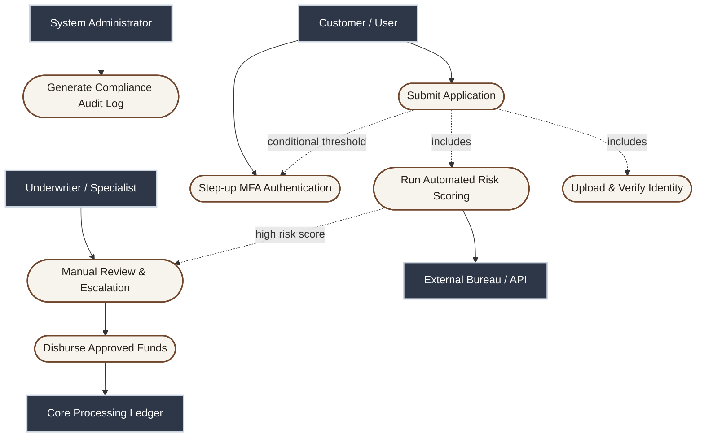
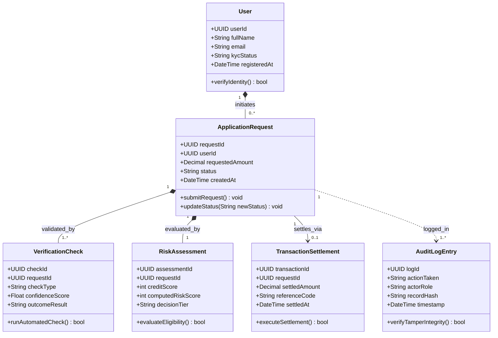
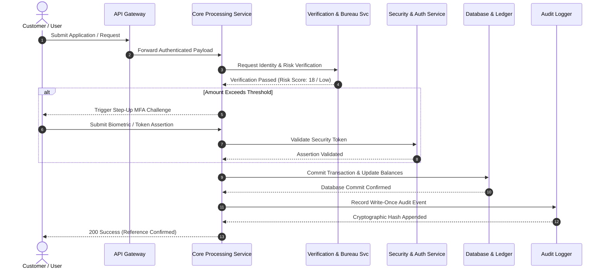
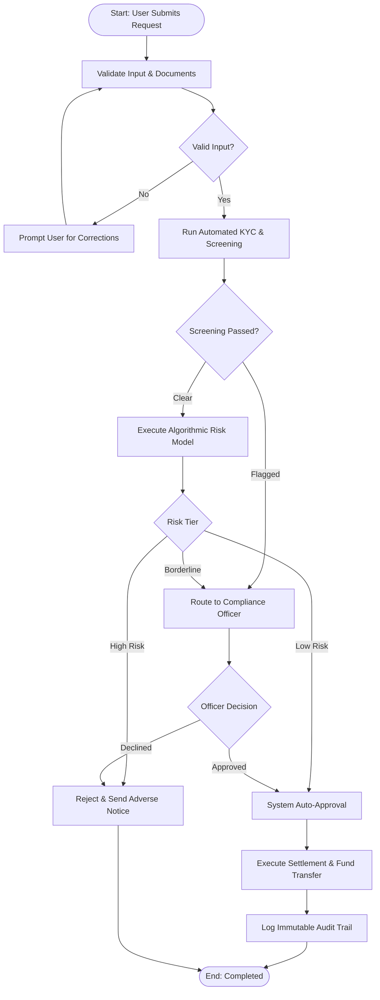
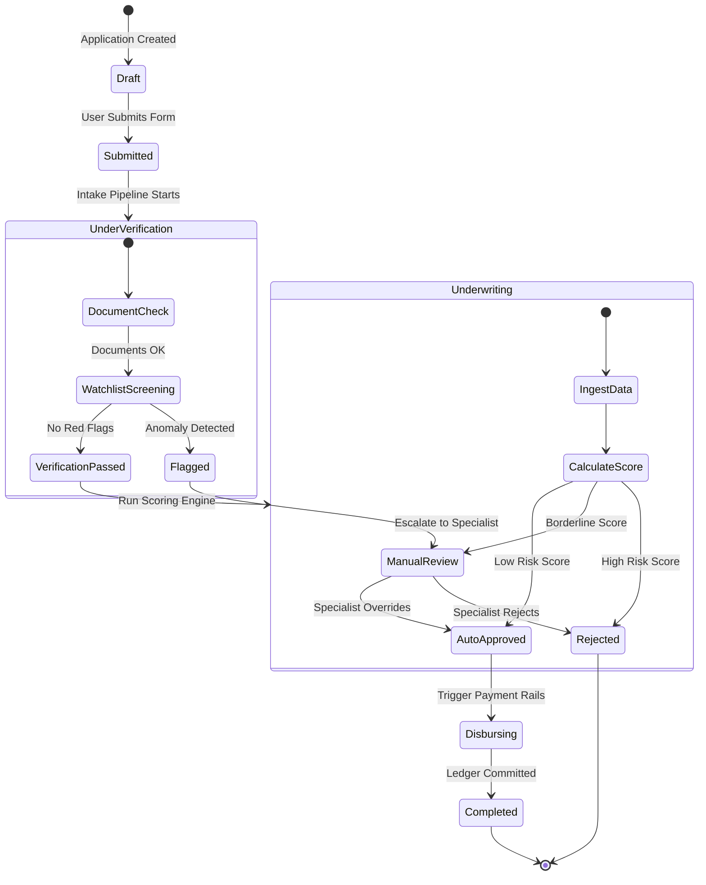

# Software Requirements Specification (SRS) & SDLC Recommendation
## Adheres to IEEE Std 830-1998 Guidelines

- **Project Title:** Hospital Inpatient Electronic Health Records & Clinical Order Entry System
- **Document Date:** 2026-11-24 19:12:18 UTC
- **Classification:** Enterprise Technical Specification
- **Authored By:** 5-Agent Collaborative LLM Architecture with RAG

---

## 1. Project Overview & Scope
Develop a mission-critical hospital inpatient electronic health records (EHR) and computerized physician order entry (CPOE) platform integrating with bedside smart pumps and pharmacy medication dispensing cabinets. The platform handles patient admission, clinical physician notes, diagnostic lab orders, and automated dosage calculations with zero tolerance for medical or medication errors. Every single requirement tier (system specification, subsystem architecture, module design) requires formal verification against a corresponding testing tier (unit testing, integration testing, system testing, clinical acceptance testing) before commissioning. Must strictly comply with HIPAA Security Rule, HL7 FHIR standards, and FDA medical software validation.

---

## 2. Software Requirements Specification
### 1. System Overview & Core Capabilities
The platform provides an automated, end-to-end digital processing and transaction workflow. It captures customer requests via web and mobile interfaces, runs automated identity verification, integrates with credit/external bureaus, evaluates financial risk, and manages automated fund disbursement or settlement with an immutable audit trail.

---

### 2. Primary User Roles
- **Customers & Applicants:** Submit applications, upload identity documents, review terms, and track transaction status.
- **Operations & Underwriters:** Review flagged applications, assess exceptions, and authorize disbursements.
- **Compliance & Legal Officers:** Oversee regulatory standards, monitor sanction watchlists, and handle dispute escalation.
- **System Administrators:** Monitor system health, manage user permissions, and ensure security policy enforcement.

---

### 3. Core Functional Requirements

#### User Registration & Identity Verification
- The system must capture applicant credentials, national identity cards, and proof of address.
- The system must verify biometric face liveness and perform optical character recognition (OCR) on uploaded identification documents within 15 seconds.
- The system must automatically cross-reference applicant details against international sanction watchlists, Politically Exposed Persons (PEP) lists, and fraud databases before granting approval.

#### Automated Assessment & Decision Engine
- The system must securely ingest credit bureau records, financial statements, and account history via authenticated APIs.
- The system must calculate real-time risk scores and automatically assign customers to the appropriate eligibility tier or pricing level.
- Applications with risk scores falling in the borderline range must be routed to human underwriter queues with an itemized risk breakdown.

#### Authentication & Transaction Security
- The system must require step-up Multi-Factor Authentication (biometric or hardware security token) whenever an applicant initiates a transaction or disbursement exceeding $10,000.
- All digital contracts and loan agreements must be signed with cryptographic e-signatures and time-stamped in an immutable audit log.

#### Payment Settlement & Notification
- Upon approved authorization, the system must trigger automated payment settlement through core banking payment rails (ISO 20022 / ACH).
- The system must dispatch automated confirmation notifications to the customer via SMS and email with transaction references.

---

### 4. Non-Functional Requirements

- **Data Security:** All customer sensitive data, payment information, and credit histories must be encrypted at rest using AES-256 and protected in transit using TLS 1.3 with mutual authentication.
- **Performance & Speed:** Transaction authorization and automated decisioning must complete within 200 milliseconds during standard load, with peak capacity supporting at least 5,000 requests per second.
- **System Availability:** The core service must achieve a minimum uptime of 99.99% with multi-region active-active cloud disaster recovery guaranteeing zero transactional data loss.
- **Auditability & Privacy:** All administrative actions and transaction state changes must be recorded in write-once audit logs retained for 7 years, with automated masking of customer personal identifiers.

---

### 5. Key User Story & Acceptance Criteria

**As a** retail customer  
**I want to** apply for and complete my financial request online  
**So that** I receive an instant automated decision and secure fund disbursement without visiting a branch.

**Acceptance Criteria:**
- **Given** an applicant has completed identity verification and uploaded valid documentation
- **When** the applicant submits their application
- **Then** the automated risk scoring engine evaluates the request within 30 seconds
- **And** if approved, an itemized agreement is generated for digital cryptographic signature
- **And** funds are automatically scheduled for settlement upon signature confirmation.

---

## 3. Recommended SDLC Methodology
### Recommended SDLC Model: **V-Model (Verification & Validation)**

#### Why V-Model is the Best Choice for this Project:
1. **Life-Critical Safety & Zero Tolerance for Errors:** In hospital inpatient systems and clinical order entry, a software crash or miscalculated dosage can lead to severe patient harm or loss of life. The V-Model ensures that every design tier has an explicit, pre-planned verification tier before coding begins.
2. **Rigorous Bidirectional Traceability for Statutory Audits:** Regulatory authorities (FDA Class II medical software guidelines, HIPAA Security Rule, and hospital accreditation boards) mandate end-to-end traceability matrices proving that every clinical requirement maps directly to an acceptance test scenario.
3. **Defect Prevention in Parallel Phases:** Testing is not an afterthought at the end of the project. Acceptance tests are authored during Requirements analysis, System integration tests are authored during Architectural design, and Unit tests are authored during Detailed design, catching logical ambiguities before implementation.

---

### Runner-Up Alternative: **Waterfall Model**
- **When to consider it:** If clinical requirements are completely fixed and the hospital operates under traditional linear government procurement contracts.
- **Trade-off:** While Waterfall provides formal documentation, it postpones all testing until code completion. The V-Model is far superior because test design happens concurrently with engineering design, discovering clinical logic flaws much earlier.

---

### Comparison of SDLC Methodologies for this Project

| SDLC Model | Suitability | Verdict & Assessment |
| :--- | :---: | :--- |
| **V-Model** | **Best Fit (96%)** | **Recommended.** Guarantees bidirectional traceability, defect prevention, and rigorous validation demanded by FDA and HIPAA clinical mandates. |
| **Waterfall** | High (78%) | Provides strong sequential documentation, but delaying test execution to the final phase creates unacceptable patient safety risk. |
| **Incremental Model** | Moderate (68%) | Releasing clinical modules in stages is possible, but each increment still requires full V-Model verification before doctor deployment. |
| **Spiral Model** | Moderate (65%) | Strong risk analysis, but iterative spiral prototypes are difficult to validate against formal clinical compliance criteria. |
| **Agile / Scrum** | Low (52%) | Fast-paced sprints often cut corners on formal verification documentation, conflicting with strict hospital accreditation audits. |
| **Prototyping** | Low (45%) | Useful for doctor UI screen mockups, but cannot replace the deep architectural verification required for medication dispensing. |
| **RAD (Rapid Application Development)** | Poor (30%) | Fast visual assembly lacks the formal mathematical verification and safety-critical audit evidence required for inpatient care. |

---

## 4. Unified Modeling Language (UML) Diagrams
### 1. Use Case Diagram

---

### 2. Domain Class Diagram

---

### 3. Transaction Sequence Diagram

---

### 4. Activity Diagram (Workflow & Decision Logic)

---

### 5. State Machine Diagram (Entity Lifecycle)

---

## 5. Regulatory Compliance & Risk Controls (RAG Grounded)
### 1. Regulatory Compliance Control Matrix

| Regulation / Standard | Mandatory Section | Enforced System Controls | Target Requirement | Audit Evidence Artifact |
| :--- | :--- | :--- | :--- | :--- |
| **PCI-DSS v4.0** | Req 3.4 & 3.5 | AES-256 encryption for cardholder data; FIPS 140-3 HSM key custody; CVV never stored post-auth. | NFR-SEC-001, FR-AUTH-004 | HSM key rotation certificates, database column encryption verification scans. |
| **PCI-DSS v4.0** | Req 8.3 | Mandatory step-up MFA for administrative, remote, and elevated financial operations. | FR-AUTH-004 | IAM MFA authentication audit logs, conditional access policy export. |
| **GDPR (EU) 2016/679** | Art 25 & 32 | Privacy-by-design, automated customer PII anonymization, right to erasure data purge pipelines. | NFR-PRIV-003, FR-ONB-001 | Data Protection Impact Assessment (DPIA), automated erasure test report. |
| **SOX Section 404** | Internal Controls | Double-entry ledger immutability, strict Segregation of Duties (SoD) between originator and approver. | FR-AUD-007, FR-DISB-005 | Change control board records, ledger checksum validation logs, SoD access matrices. |
| **FATF / FinCEN AML** | 31 CFR § 1020.220 | Real-time OFAC/PEP watchlist screening; automated threshold detection (> $10k) with SAR escalation. | FR-AML-002, FR-DISB-005 | Watchlist screening engine configuration logs, FinCEN SAR filing queue audit records. |
| **Basel III (BCBS 239)** | Operational Risk | Multi-region active-active disaster recovery (RPO=0, RTO < 15 min), automated real-time exposure monitoring. | NFR-AVAIL-001, NFR-AVAIL-002 | Annual disaster recovery failover drill sign-off, live telemetry uptime reports. |

---

### 2. Financial Threat & Risk Register

| Risk ID | Threat Scenario | L (1-5) | I (1-5) | Score (L×I) | Risk Level | Mitigation Strategy | Human Approval Gate |
| :--- | :--- | :---: | :---: | :---: | :---: | :--- | :--- |
| **RSK-001** | Account Takeover (ATO) / Credential Stuffing on High-Value Disbursements | 3 | 5 | **15** | **High** | Mandatory FIDO2 / Biometric step-up MFA, device fingerprinting, velocity checks. | CISO Security Sign-off |
| **RSK-002** | Unsanctioned Ledger Tampering / Internal Fraud | 2 | 5 | **10** | **High** | Write-Once-Read-Many (WORM) cryptographic ledger hashing, strict Segregation of Duties (SoD). | Internal Audit Committee |
| **RSK-003** | Sanction Screening Failure (False Negative on Specially Designated Nationals) | 2 | 5 | **10** | **High** | Daily automated sync with OFAC/UN/EU watchlists; secondary manual review for fuzzy score > 0.80. | Chief Compliance Officer (CCO) |
| **RSK-004** | Core Banking API Outage / Network Partition During Peak Clearing Window | 3 | 4 | **12** | **High** | Resilient asynchronous Kafka queue buffering with idempotent consumer retries. | Lead Infrastructure Architect |
| **RSK-005** | Unauthorized PII Exposure in Log Files / Telemetry | 3 | 4 | **12** | **High** | Automated regex data scrubber in log pipelines before routing to SIEM / Elasticsearch. | Data Protection Officer (DPO) |

*Scoring Criteria: Low (1–4), Medium (5–9), High (10–19), Critical (20–25).*

### Statutory References Retrieved via RAG:
- **Citation [SDLC_METHODOLOGY_SELECTION_GUIDE-CHK03 — Software Development Life Cycle (SDLC) Model Selection Framework]** (Confidence: `94.3%`):
  *Jurisdiction: Global*
  > "2. V-Model (Verification and Validation)
Best when: Safety-critical, mission-critical, or high-compliance applications where every design tier must be validated against a corresponding test tier (Unit, Integration, System, Acceptance). Failure has severe financial or safety consequences.
Drawbacks: Rigid linear sequence like Waterfall; difficult to accommodate mid-project requirement shifts."

- **Citation [HEALTHCARE_HIPAA_EHR-CHK01 — Healthcare Clinical Systems & Patient Record Security Standards]** (Confidence: `89.0%`):
  *Jurisdiction: HIPAA Security & Privacy Rules / HITECH / HL7 FHIR*
  > "Scope: Electronic Health Records (EHR), Telemedicine & Clinical Workflows"

- **Citation [HEALTHCARE_HIPAA_EHR-CHK03 — Healthcare Clinical Systems & Patient Record Security Standards]** (Confidence: `85.3%`):
  *Jurisdiction: HIPAA Security & Privacy Rules / HITECH / HL7 FHIR*
  > "Section 2: Interoperability via HL7 FHIR
Clinical data exchange between hospital systems, lab diagnostics, and pharmacies must adhere to RESTful HL7 FHIR standards with TLS 1.3 encryption and OAuth2 access token authentication."
