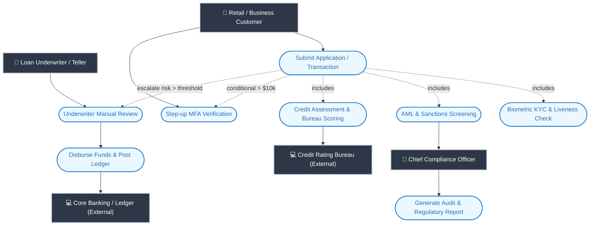
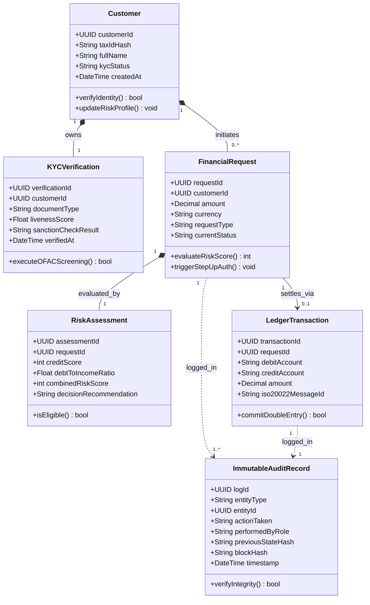
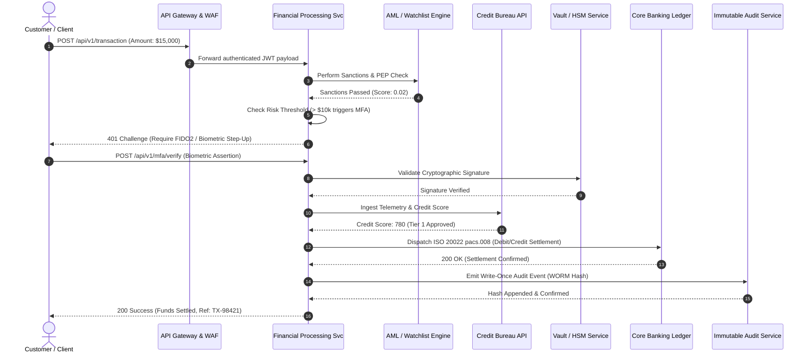
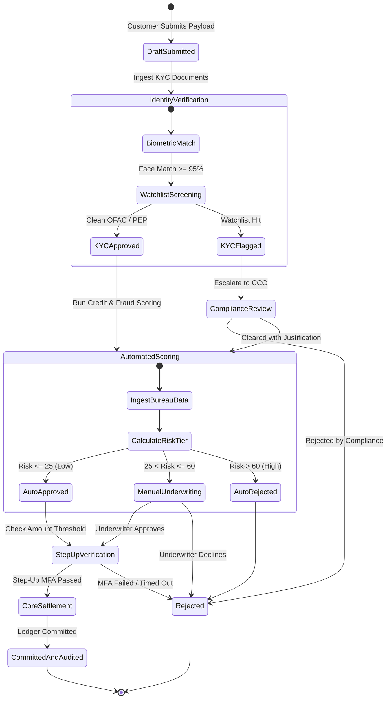
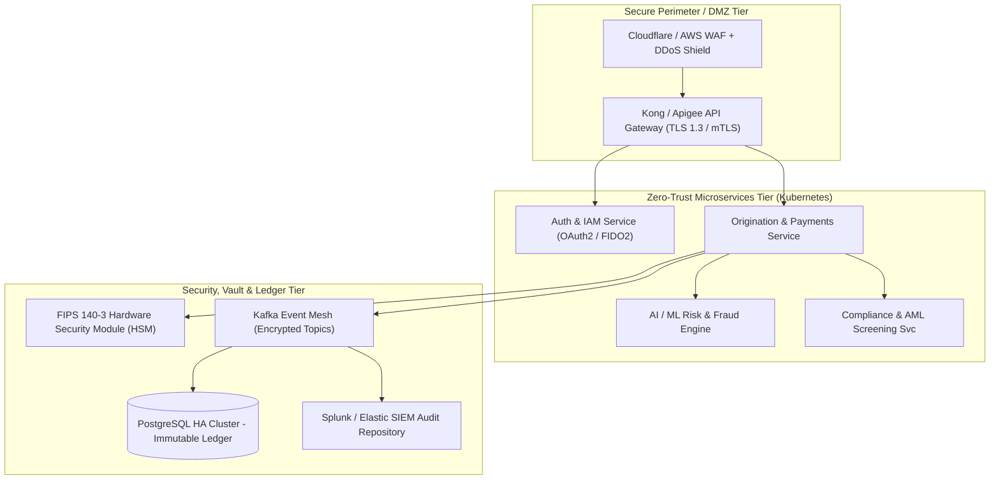
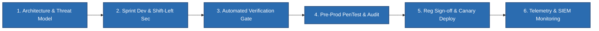

# Software Requirements Specification (SRS) & SDLC Strategy Report
## Standard Adherence: IEEE Std 830-1998 & ISO/IEC/IEEE 29148:2018
### Target Domain: Mission-Critical Financial Services Architecture

- **Project Title:** Next-Gen Omnichannel Digital Banking & Customer Onboarding (KYC)
- **Document Version:** 1.0.0 (Baseline Draft)
- **Generated On:** 2026-11-14 16:39:24 UTC
- **Security Classification:** Financial Confidential / Restricted Distribution
- **Authoring Engine:** Financial Agentic-AI Multi-Agent System

---

## 1. System Overview & Scope Definition

### 1.1 Executive Summary
Build a secure omnichannel retail digital banking platform with customer onboarding, account opening, account management, and fund transfers. New customers register via mobile with OCR extraction of passport/driver's license, liveness detection, and automated sanctions/PEP screening. Existing customers can view balances, transfer funds with daily limits, set up recurring bill payments, and request account statements. The platform must implement end-to-end encryption, step-up MFA, Open Banking / PSD2 compliant APIs, and rigorous audit trails for all operations.

### 1.2 Multi-Agent Architecture Overview
This document was authored through autonomous collaboration among five specialized AI agents:
1. **Stakeholder Interaction & Clarification Agent:** Elicitation of business, security, compliance, and user roles.
2. **Requirements Engineering & Classification Agent:** Formulation of IEEE 830 compliant functional and non-functional requirements.
3. **Compliance, Security & Risk Agent:** Statutory mapping against PCI-DSS v4.0, GDPR, SOX 404, Basel III, and AML/KYC.
4. **UML Diagrams & Architectural Agent:** Synthesis of domain class diagrams, transaction sequence flows, and system topologies.
5. **SDLC Selection Engine Agent:** Multi-Criteria Decision Analysis (MCDA) for methodology ranking and tailored validation gates.

---

## 2. Stakeholder Requirements & Elicitation Findings
### 1. Stakeholder Group Matrix & Elicitation Scope

| Stakeholder Role | Primary Focus Area | Key Elicited Perspectives |
| :--- | :--- | :--- |
| **Product Owner & Business Ops** | Business value, conversion, throughput | Target customer segments, loan/transaction SLA, credit decision turn-around time (< 60s) |
| **CISO & InfoSec Team** | Confidentiality, integrity, threat protection | Zero-trust architecture, TLS 1.3, HSM-backed tokenization, step-up MFA, AES-256 at rest |
| **Chief Compliance Officer (CCO)** | Regulatory compliance & auditability | PCI-DSS v4.0, SOX 404, GDPR right-to-erasure, FinCEN AML/KYC automated reporting |
| **Chief Architect & DevOps** | Resilience, scalability, integration | 99.99% availability, RPO=0, RTO < 15 min, microservices, Kafka event streaming, legacy core banking connectors |
| **Auditor / Risk Committee** | Traceability & non-repudiation | Write-once read-many (WORM) audit logging, Segregation of Duties (SoD), change-control gates |

---

### 2. Context-Aware Clarification & Ambiguity Analysis

1. **Transaction Velocity & Scalability Bounds:**
   - *Clarification:* What are peak TPS (transactions per second) requirements and maximum allowable p99 latency during high-volume settlement windows?
   - *Resolution Target:* Baseline capacity defined at 5,000 TPS baseline, 25,000 TPS peak, sub-100ms response time.

2. **Step-Up Authentication & Risk-Based Step Thresholds:**
   - *Clarification:* What monetary transfer or loan disbursement threshold triggers mandatory secondary out-of-band verification?
   - *Resolution Target:* Transactions > $10,000 (or anomalous risk score > 75/100) require mandatory biometric / hardware token MFA.

3. **Legacy Core Banking Interoperability:**
   - *Clarification:* Are core banking accounting ledgers updated via batch EOD files (ACH/NACHA) or synchronous real-time ISO 20022 message APIs?
   - *Resolution Target:* Dual-mode: real-time ISO 20022 REST/gRPC events with end-of-day reconciliation batch sync.

4. **Data Retention & Sovereignty Constraints:**
   - *Clarification:* What are the exact geographical jurisdiction data-residency boundaries and statutory retention rules?
   - *Resolution Target:* Financial ledger records retained for 7 years (SOX/IRS); PII subject to GDPR right-to-erasure masking after account closure.


---

## 3. Formal Software Requirements Specification (IEEE 830 / 29148)
### 1. Functional Requirements (IEEE Std 830 / ISO/IEC/IEEE 29148)

| Req ID | Requirement Statement (SHALL / SHALL NOT) | Category | MoSCoW | Traceability |
| :--- | :--- | :--- | :--- | :--- |
| **FR-ONB-001** | The system **SHALL** capture customer identification documents (passport, driver's license), perform automated OCR, and verify liveness via biometric facial recognition within 15 seconds of submission. | Onboarding / KYC | **Must Have** | REQ-STK-001 / AML-CIP |
| **FR-AML-002** | The system **SHALL** cross-reference applicant data against international PEP, OFAC sanctions, and adverse media watchlists prior to account or loan approval. | Compliance / AML | **Must Have** | REQ-STK-002 / BSA-AML |
| **FR-CRED-003** | The system **SHALL** ingest credit bureau telemetry (credit score, debt-to-income, active credit facilities) and execute the automated credit decision algorithm to determine interest rate tier and loan eligibility. | Underwriting | **Must Have** | REQ-STK-003 / FCRA |
| **FR-AUTH-004** | The system **SHALL** enforce step-up Multi-Factor Authentication (biometric or FIDO2 hardware token) for any single transaction or loan disbursement exceeding $10,000. | Security / Payments | **Must Have** | REQ-STK-004 / PCI-DSS-REQ8 |
| **FR-DISB-005** | Upon verified loan approval and cryptographic e-signature, the system **SHALL** generate an ISO 20022 `pacs.008` financial payment message to trigger fund disbursement to the recipient core banking account. | Core Settlement | **Must Have** | REQ-STK-005 / ISO-20022 |
| **FR-DISP-006** | The system **SHALL** provide an automated dispute and chargeback intake portal allowing customers to lodge transaction contestations within 60 days of statement generation. | Customer Operations | **Should Have** | REQ-STK-006 / Reg-E |
| **FR-AUD-007** | The system **SHALL** record an immutable, cryptographically hashed audit log for every transaction state change, administrative access, and policy override. | Audit / SOX | **Must Have** | REQ-STK-007 / SOX-404 |

---

### 2. Non-Functional Requirements (NFR)

#### Security & Privacy (ISO/IEC 27001 & GDPR)
- **NFR-SEC-001 (Data Encryption at Rest):** All sensitive financial data, Personally Identifiable Information (PII), and credit assessment records **SHALL** be encrypted at rest using AES-256 with encryption keys managed inside a FIPS 140-3 Level 3 validated Hardware Security Module (HSM).
- **NFR-SEC-002 (In-Transit Protection):** All external and inter-service communication **SHALL** strictly mandate TLS 1.3 with mutual authentication (mTLS) and cipher suites supporting Perfect Forward Secrecy (PFS).
- **NFR-PRIV-003 (Data Minimization & Masking):** Cardholder Primary Account Numbers (PAN) and National ID numbers **SHALL** be masked across all user interfaces, exposing at most the first 6 and final 4 digits.

#### Performance & Scalability
- **NFR-PERF-001 (Throughput):** The transaction processing engine **SHALL** support a sustained throughput of at least 5,000 transactions per second (TPS) with peak burst elasticity handling up to 25,000 TPS.
- **NFR-PERF-002 (Response Time Latency):** In-flight transaction authorization and automated credit decisioning **SHALL** return a final response within 200 milliseconds at the 99th percentile (p99).

#### Availability, Disaster Recovery & Resilience (Basel III BCBS 239)
- **NFR-AVAIL-001 (High Availability):** Core financial services **SHALL** maintain a minimum service availability of 99.99% (maximum unplanned downtime < 52.6 minutes/year).
- **NFR-AVAIL-002 (Recovery Targets):** The system architecture **SHALL** guarantee a Recovery Point Objective (RPO) of 0 (zero transactional data loss) and a Recovery Time Objective (RTO) of less than 15 minutes via multi-region synchronous replication.

---

### 3. Representative Acceptance Criteria (Given-When-Then)

```gherkin
Scenario: Automated Step-up Authentication on High-Value Fund Disbursement
  Given a customer is authenticated on the digital banking platform
  And the requested loan disbursement or wire transfer amount is $15,000 (exceeds $10,000 threshold)
  When the customer clicks "Confirm & Disburse Funds"
  Then the system SHALL prompt for secondary biometric / FIDO2 authentication
  And the system SHALL NOT commit the ledger transaction until the out-of-band verification succeeds
  And the transaction approval along with device risk fingerprint SHALL be recorded in the immutable audit log.
```


---

## 4. Regulatory Compliance & Threat Risk Assessment
### 1. Regulatory Compliance Control Matrix

| Regulation / Standard | Mandatory Section | Enforced System Controls | Target Requirement | Audit Evidence Artifact |
| :--- | :--- | :--- | :--- | :--- |
| **PCI-DSS v4.0** | Req 3.4 & 3.5 | AES-256 encryption for cardholder data; FIPS 140-3 HSM key custody; CVV never stored post-auth. | NFR-SEC-001, FR-AUTH-004 | HSM key rotation certificates, database column encryption verification scans. |
| **PCI-DSS v4.0** | Req 8.3 | Mandatory step-up MFA for administrative, remote, and elevated financial operations. | FR-AUTH-004 | IAM MFA authentication audit logs, conditional access policy export. |
| **GDPR (EU) 2016/679** | Art 25 & 32 | Privacy-by-design, automated customer PII anonymization, right to erasure data purge pipelines. | NFR-PRIV-003, FR-ONB-001 | Data Protection Impact Assessment (DPIA), automated erasure test report. |
| **SOX Section 404** | Internal Controls | Double-entry ledger immutability, strict Segregation of Duties (SoD) between originator and approver. | FR-AUD-007, FR-DISB-005 | Change control board records, ledger checksum validation logs, SoD access matrices. |
| **FATF / FinCEN AML** | 31 CFR § 1020.220 | Real-time OFAC/PEP watchlist screening; automated threshold detection (> $10k) with SAR escalation. | FR-AML-002, FR-DISB-005 | Watchlist screening engine configuration logs, FinCEN SAR filing queue audit records. |
| **Basel III (BCBS 239)** | Operational Risk | Multi-region active-active disaster recovery (RPO=0, RTO < 15 min), automated real-time exposure monitoring. | NFR-AVAIL-001, NFR-AVAIL-002 | Annual disaster recovery failover drill sign-off, live telemetry uptime reports. |

---

### 2. Financial Threat & Risk Register

| Risk ID | Threat Scenario | L (1-5) | I (1-5) | Score (L×I) | Risk Level | Mitigation Strategy | Human Approval Gate |
| :--- | :--- | :---: | :---: | :---: | :---: | :--- | :--- |
| **RSK-001** | Account Takeover (ATO) / Credential Stuffing on High-Value Disbursements | 3 | 5 | **15** | **High** | Mandatory FIDO2 / Biometric step-up MFA, device fingerprinting, velocity checks. | CISO Security Sign-off |
| **RSK-002** | Unsanctioned Ledger Tampering / Internal Fraud | 2 | 5 | **10** | **High** | Write-Once-Read-Many (WORM) cryptographic ledger hashing, strict Segregation of Duties (SoD). | Internal Audit Committee |
| **RSK-003** | Sanction Screening Failure (False Negative on Specially Designated Nationals) | 2 | 5 | **10** | **High** | Daily automated sync with OFAC/UN/EU watchlists; secondary manual review for fuzzy score > 0.80. | Chief Compliance Officer (CCO) |
| **RSK-004** | Core Banking API Outage / Network Partition During Peak Clearing Window | 3 | 4 | **12** | **High** | Resilient asynchronous Kafka queue buffering with idempotent consumer retries. | Lead Infrastructure Architect |
| **RSK-005** | Unauthorized PII Exposure in Log Files / Telemetry | 3 | 4 | **12** | **High** | Automated regex data scrubber in log pipelines before routing to SIEM / Elasticsearch. | Data Protection Officer (DPO) |

*Scoring Criteria: Low (1–4), Medium (5–9), High (10–19), Critical (20–25).*


---

## 5. Unified Modeling Language (UML) System Specifications
### 1. System Use Case Diagram (Financial Domain)



---

### 2. Domain Class Diagram (Entities & Relationships)



---

### 3. Transaction Sequence Diagram (High-Value Operation)



---

### 4. Activity & State Machine Diagram



---

### 5. High-Availability Component & Security Architecture




---

## 6. Software Development Life Cycle (SDLC) Strategy & Roadmap
### 1. Multi-Criteria Decision Analysis (MCDA) Scoring

| Rank | SDLC Methodology | Match Score | Key Suitability Driver |
| :---: | :--- | :---: | :--- |
| **1** | **Agile-DevSecOps Hybrid** | `95%` | Combines rapid iteration with automated security & continuous compliance gates. |
| **2** | **V-Model (Verification & Validation)** | `81%` | High rigor for safety-critical testing corresponding to each design tier. |
| **3** | **Spiral Model** | `76%` | Iterative risk reduction suited for high algorithmic or architectural uncertainty. |
| **4** | **Traditional Waterfall** | `50%` | Linear progression with heavy documentation; rigid for modern cloud deployments. |
| **5** | **Pure Agile (Scrum / Kanban)** | `45%` | High team flexibility but requires supplementary controls for financial audits. |

---

### 2. Primary Recommendation: **Agile-DevSecOps Hybrid**

#### Rationale & Strategic Alignment:
1. **Regulatory Compliance as Code:** Financial standards (PCI-DSS v4.0, SOX 404, GDPR) prohibit manual, ad-hoc approvals. DevSecOps embeds automated compliance policy checks directly into CI/CD pipelines.
2. **Shift-Left Security:** Automated SAST (Static Application Security Testing), DAST, dependency vulnerability scanning, and container signing happen before code merges to main.
3. **Continuous Delivery with Formal Gates:** Agile sprints ensure rapid feature delivery, while automated audit trail generation ensures compliance officers have non-repudiable evidence for regulators.

---

### 3. Customized Financial SDLC Workflow & Validation Gates



#### Detailed Phase Breakdown:

| Phase | Core Engineering Activities | Security & Compliance Controls | Mandatory Deliverables | Human Approval Checkpoint |
| :--- | :--- | :--- | :--- | :--- |
| **Phase 1: Inception & Architecture** | Domain modeling, API contract definitions, schema design. | STRIDE Threat Modeling, Data Protection Impact Assessment (DPIA). | Architecture Design Doc, Threat Model Register, Data Flow Diagram. | **Security Architect & CISO Sign-off** |
| **Phase 2: Sprint Implementation** | Two-week Agile sprints, microservice development, unit testing. | Pre-commit git hooks, dependency check (OWASP Dependency-Check), secret scanning. | Reviewed PRs, 85%+ Unit Test Coverage, clean SonarQube quality gate. | **Lead Developer & Peer Review** |
| **Phase 3: Automated Verification** | Integration testing, mock core banking settlement tests. | Automated SAST (Semgrep/Checkmarx), DAST (OWASP ZAP), container image signing (Cosign). | Automated Test Reports, Vulnerability Scan Report (0 High/Critical). | **DevSecOps Platform Lead** |
| **Phase 4: Staging & Audit Gate** | End-to-end user acceptance testing (UAT), stress & load testing (25k TPS). | Third-party grey-box Penetration Testing, SoD segregation check, mock audit run. | Penetration Test Remediation Report, UAT Sign-off document. | **External QSA / Audit Lead** |
| **Phase 5: Release & Canary Deploy** | Blue-Green / Canary deployment (5% -> 25% -> 100%), automated rollback triggers. | FIPS 140-3 HSM key validation, production IAM lock-down, TLS 1.3 verification. | Deployment Runbook, Production Release Notes, Cryptographic Hashes. | **Change Advisory Board (CAB) & CCO** |
| **Phase 6: Post-Deploy & Monitoring** | Live transaction processing, synthetic health pings. | 24/7 SIEM monitoring, automated fraud anomaly detection, quarterly key rotation. | Real-time SLA Dashboards, Monthly Incident & Compliance Reports. | **SecOps & Operations Manager** |


---

## 7. Governance, Verification & Human-in-the-Loop Sign-Off
### Multi-Agent Governance & Audit Trail

| Audit Timestamp (UTC) | Workflow Stage | Agent Responsible | Status | Checkpoint Summary |
| :--- | :--- | :--- | :---: | :--- |
| 2026-11-14T16:39:24.537522Z | Stage 1 | Stakeholder Interaction & Clarification Agent | **COMPLETED** | Elicited stakeholder matrix and clarified constraints. |
| 2026-11-14T16:39:24.537587Z | Stage 2 | Requirements Engineering & Classification Agent | **COMPLETED** | Generated IEEE 830 / 29148 FRs, NFRs, and acceptance criteria. |
| 2026-11-14T16:39:24.537624Z | Stage 3 | Compliance, Security & Risk Analysis Agent | **COMPLETED** | Constructed Compliance Control Matrix and Risk Register (L x I). |
| 2026-11-14T16:39:24.537655Z | Stage 4 | UML Diagrams & Architectural Modeling Agent | **COMPLETED** | Rendered Mermaid UML models (Use Case, Class, Sequence, State, Architecture). |
| 2026-11-14T16:39:24.537771Z | Stage 5 | SDLC Selection Engine Agent | **COMPLETED** | Computed MCDA rankings and customized Phase Roadmap with Validation Gates. |

#### Mandatory Human-in-the-Loop (HITL) Approval Checkpoints:
1. **Requirements Baseline Approval:** Sign-off by Lead Systems Analyst & Product Owner.
2. **Regulatory & Security Mapping Verification:** Sign-off by Chief Compliance Officer (CCO) and CISO.
3. **SDLC Methodology & Release Gates Approval:** Sign-off by Software Engineering Director & QA Lead.


### 7.1 Formal Sign-off & Verification Register

| Stakeholder Role | Name / Title | Signature | Date | Approval Status |
| :--- | :--- | :--- | :--- | :--- |
| **Lead Systems Analyst** | ____________________ | ____________________ | ____/____/2026 | [ ] Approved  [ ] Changes Requested |
| **Chief Compliance Officer (CCO)** | ____________________ | ____________________ | ____/____/2026 | [ ] Approved  [ ] Changes Requested |
| **Chief Information Security Officer (CISO)** | ____________________ | ____________________ | ____/____/2026 | [ ] Approved  [ ] Changes Requested |
| **Lead Solutions Architect** | ____________________ | ____________________ | ____/____/2026 | [ ] Approved  [ ] Changes Requested |
