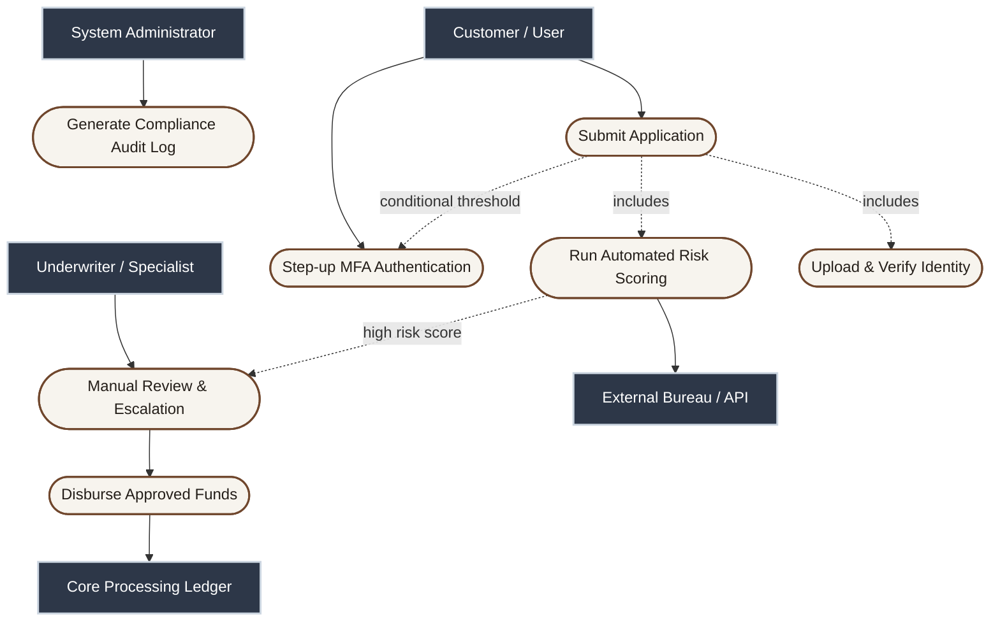
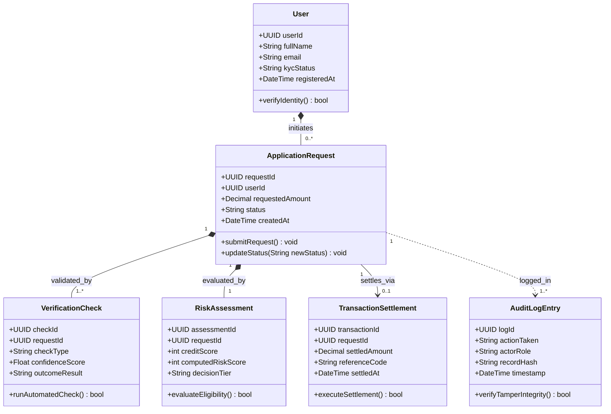
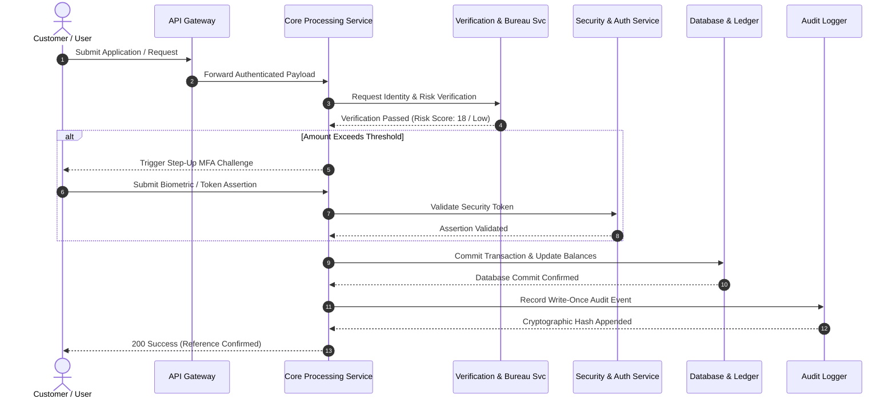
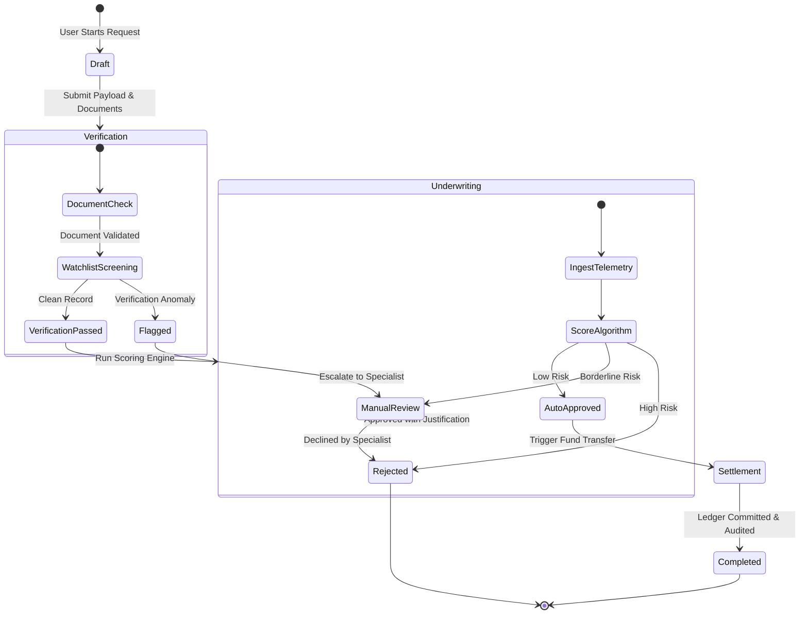

# Software Requirements Specification (SRS) & SDLC Recommendation
## Adheres to IEEE Std 830-1998 Guidelines

- **Project Title:** Omnichannel Digital Banking & KYC Onboarding Platform
- **Document Date:** 2026-11-24 19:01:32 UTC
- **Classification:** Enterprise Technical Specification
- **Authored By:** 5-Agent Collaborative LLM Architecture with RAG

---

## 1. Project Overview & Scope
Build a secure omnichannel retail digital banking platform with customer onboarding, account opening, account management, and fund transfers. New customers register via mobile with OCR extraction of passport/driver's license, liveness detection, and automated sanctions/PEP screening. Existing customers can view balances, transfer funds with daily limits, set up recurring bill payments, and request account statements. The platform must implement end-to-end encryption, step-up MFA, and Open Banking APIs.

---

## 2. Software Requirements Specification
### 1. System Overview & Core Capabilities
The platform provides an automated, end-to-end digital processing and transaction workflow. It captures customer requests via web and mobile interfaces, runs automated identity verification, integrates with credit/external bureaus, evaluates financial risk, and manages automated fund disbursement or settlement with an immutable audit trail.

---

### 2. Primary User Roles
- **Customers & Applicants:** Submit applications, upload identity documents, review terms, and track transaction status.
- **Operations & Underwriters:** Review flagged applications, assess exceptions, and authorize disbursements.
- **Compliance & Legal Officers:** Oversee regulatory standards, monitor sanction watchlists, and handle dispute escalation.
- **System Administrators:** Monitor system health, manage user permissions, and ensure security policy enforcement.

---

### 3. Core Functional Requirements

#### User Registration & Identity Verification
- The system must capture applicant credentials, national identity cards, and proof of address.
- The system must verify biometric face liveness and perform optical character recognition (OCR) on uploaded identification documents within 15 seconds.
- The system must automatically cross-reference applicant details against international sanction watchlists, Politically Exposed Persons (PEP) lists, and fraud databases before granting approval.

#### Automated Assessment & Decision Engine
- The system must securely ingest credit bureau records, financial statements, and account history via authenticated APIs.
- The system must calculate real-time risk scores and automatically assign customers to the appropriate eligibility tier or pricing level.
- Applications with risk scores falling in the borderline range must be routed to human underwriter queues with an itemized risk breakdown.

#### Authentication & Transaction Security
- The system must require step-up Multi-Factor Authentication (biometric or hardware security token) whenever an applicant initiates a transaction or disbursement exceeding $10,000.
- All digital contracts and loan agreements must be signed with cryptographic e-signatures and time-stamped in an immutable audit log.

#### Payment Settlement & Notification
- Upon approved authorization, the system must trigger automated payment settlement through core banking payment rails (ISO 20022 / ACH).
- The system must dispatch automated confirmation notifications to the customer via SMS and email with transaction references.

---

### 4. Non-Functional Requirements

- **Data Security:** All customer sensitive data, payment information, and credit histories must be encrypted at rest using AES-256 and protected in transit using TLS 1.3 with mutual authentication.
- **Performance & Speed:** Transaction authorization and automated decisioning must complete within 200 milliseconds during standard load, with peak capacity supporting at least 5,000 requests per second.
- **System Availability:** The core service must achieve a minimum uptime of 99.99% with multi-region active-active cloud disaster recovery guaranteeing zero transactional data loss.
- **Auditability & Privacy:** All administrative actions and transaction state changes must be recorded in write-once audit logs retained for 7 years, with automated masking of customer personal identifiers.

---

### 5. Key User Story & Acceptance Criteria

**As a** retail customer  
**I want to** apply for and complete my financial request online  
**So that** I receive an instant automated decision and secure fund disbursement without visiting a branch.

**Acceptance Criteria:**
- **Given** an applicant has completed identity verification and uploaded valid documentation
- **When** the applicant submits their application
- **Then** the automated risk scoring engine evaluates the request within 30 seconds
- **And** if approved, an itemized agreement is generated for digital cryptographic signature
- **And** funds are automatically scheduled for settlement upon signature confirmation.

---

## 3. Recommended SDLC Methodology
### Recommended SDLC Model: **Agile / Scrum**

#### Why Agile / Scrum is the Best Choice for this Project:
1. **Iterative Delivery with Fast Feedback:** Financial and transaction systems require frequent testing and validation of business rules with stakeholders. Scrum's two-week sprint cycles allow the team to deliver working software incrementally while continuously incorporating feedback.
2. **Adapting to Evolving Regulations & APIs:** Financial regulations and external third-party APIs (credit bureaus, KYC verification, payment gateways) frequently change. Agile accommodates shifting interface specifications without halting development.
3. **Continuous Integration & Quality:** Automated unit tests, security scans, and code reviews are integrated into daily sprint builds, catching defects early rather than waiting until the end of the project.

---

### Runner-Up Alternative: **V-Model (Verification & Validation)**
- **When to consider it:** If your institution mandates rigid, upfront regulatory sign-offs where every single functional tier must have an exact corresponding test tier before coding begins.
- **Trade-off:** The V-Model provides great formal documentation and verification rigor, but it is inflexible to mid-project requirement changes and significantly slows down initial time-to-market.

---

### Comparison of SDLC Methodologies for this Project

| SDLC Model | Suitability | Verdict & Assessment |
| :--- | :---: | :--- |
| **Agile / Scrum** | **Best Fit (92%)** | **Recommended.** Delivers working modules every 2 weeks, adapts to evolving API contracts, and enables continuous automated testing. |
| **V-Model** | High (82%) | Strong for high-compliance auditing, but rigid if requirements or external partner APIs change during development. |
| **Spiral Model** | Moderate (70%) | Excellent for high-risk research or complex AI algorithms; however, process overhead is excessive for standard transaction architectures. |
| **Incremental Model** | Moderate (68%) | Good for launching a minimal baseline product first and adding modules later, but less flexible for rapid sprint iterations. |
| **Prototyping** | Low (55%) | Helpful if user interface workflows are completely unknown upfront, but adds throwaway development overhead for backend-heavy financial systems. |
| **RAD (Rapid Application Development)** | Low (45%) | Fast delivery for simple database-driven web apps, but unsuitable for high-security transaction ledgers requiring formal security audits. |
| **Waterfall** | Poor (35%) | Inflexible linear progression. Discovering integration defects during late-stage testing leads to costly delays and rework. |

---

## 4. Unified Modeling Language (UML) Diagrams
### 1. Use Case Diagram

---

### 2. Domain Class Diagram

---

### 3. Transaction Sequence Diagram

---

### 4. State & Activity Lifecycle Diagram

---

## 5. Regulatory Compliance & Risk Controls (RAG Grounded)
### 1. Regulatory Compliance Control Matrix

| Regulation / Standard | Mandatory Section | Enforced System Controls | Target Requirement | Audit Evidence Artifact |
| :--- | :--- | :--- | :--- | :--- |
| **PCI-DSS v4.0** | Req 3.4 & 3.5 | AES-256 encryption for cardholder data; FIPS 140-3 HSM key custody; CVV never stored post-auth. | NFR-SEC-001, FR-AUTH-004 | HSM key rotation certificates, database column encryption verification scans. |
| **PCI-DSS v4.0** | Req 8.3 | Mandatory step-up MFA for administrative, remote, and elevated financial operations. | FR-AUTH-004 | IAM MFA authentication audit logs, conditional access policy export. |
| **GDPR (EU) 2016/679** | Art 25 & 32 | Privacy-by-design, automated customer PII anonymization, right to erasure data purge pipelines. | NFR-PRIV-003, FR-ONB-001 | Data Protection Impact Assessment (DPIA), automated erasure test report. |
| **SOX Section 404** | Internal Controls | Double-entry ledger immutability, strict Segregation of Duties (SoD) between originator and approver. | FR-AUD-007, FR-DISB-005 | Change control board records, ledger checksum validation logs, SoD access matrices. |
| **FATF / FinCEN AML** | 31 CFR § 1020.220 | Real-time OFAC/PEP watchlist screening; automated threshold detection (> $10k) with SAR escalation. | FR-AML-002, FR-DISB-005 | Watchlist screening engine configuration logs, FinCEN SAR filing queue audit records. |
| **Basel III (BCBS 239)** | Operational Risk | Multi-region active-active disaster recovery (RPO=0, RTO < 15 min), automated real-time exposure monitoring. | NFR-AVAIL-001, NFR-AVAIL-002 | Annual disaster recovery failover drill sign-off, live telemetry uptime reports. |

---

### 2. Financial Threat & Risk Register

| Risk ID | Threat Scenario | L (1-5) | I (1-5) | Score (L×I) | Risk Level | Mitigation Strategy | Human Approval Gate |
| :--- | :--- | :---: | :---: | :---: | :---: | :--- | :--- |
| **RSK-001** | Account Takeover (ATO) / Credential Stuffing on High-Value Disbursements | 3 | 5 | **15** | **High** | Mandatory FIDO2 / Biometric step-up MFA, device fingerprinting, velocity checks. | CISO Security Sign-off |
| **RSK-002** | Unsanctioned Ledger Tampering / Internal Fraud | 2 | 5 | **10** | **High** | Write-Once-Read-Many (WORM) cryptographic ledger hashing, strict Segregation of Duties (SoD). | Internal Audit Committee |
| **RSK-003** | Sanction Screening Failure (False Negative on Specially Designated Nationals) | 2 | 5 | **10** | **High** | Daily automated sync with OFAC/UN/EU watchlists; secondary manual review for fuzzy score > 0.80. | Chief Compliance Officer (CCO) |
| **RSK-004** | Core Banking API Outage / Network Partition During Peak Clearing Window | 3 | 4 | **12** | **High** | Resilient asynchronous Kafka queue buffering with idempotent consumer retries. | Lead Infrastructure Architect |
| **RSK-005** | Unauthorized PII Exposure in Log Files / Telemetry | 3 | 4 | **12** | **High** | Automated regex data scrubber in log pipelines before routing to SIEM / Elasticsearch. | Data Protection Officer (DPO) |

*Scoring Criteria: Low (1–4), Medium (5–9), High (10–19), Critical (20–25).*

### Statutory References Retrieved via RAG:
- **Citation [AML_AND_BASEL-CHK02 — FATF Anti-Money Laundering (AML/KYC) & Basel III Operational Resilience Standards]** (Confidence: `84.9%`):
  *Jurisdiction: International / BCBS / Financial Action Task Force*
  > "FATF Recommendation 10 & 16: Customer Due Diligence (CDD) and Wire Transfer Rules
Financial customer onboarding systems must capture verifiable government identity credentials, verify biometric liveness with spoofing detection, and execute real-time automated fuzzy screening against OFAC, EU, UN Sanctions, and Politically Exposed Persons (PEP) watchlists. Single or aggregated transactions exceeding $10,000 (or local equivalent) must automatically generate Currency Transaction Reports (CTR) and trigger Suspicious Activity Report (SAR) queues with mandatory compliance officer review."

- **Citation [AML_AND_BASEL-CHK01 — FATF Anti-Money Laundering (AML/KYC) & Basel III Operational Resilience Standards]** (Confidence: `81.7%`):
  *Jurisdiction: International / BCBS / Financial Action Task Force*
  > "Scope: Customer Due Diligence, Sanctions Screening & High-Availability Resilience"

- **Citation [PCI-DSS-4.0-CHK01 — PCI-DSS v4.0 Payment Card Industry Data Security Standard]** (Confidence: `79.0%`):
  *Jurisdiction: Global / Financial Payment Card Processing*
  > "Section 3.4: Protection of Stored Primary Account Numbers (PAN)
All Primary Account Numbers (PAN) stored in cardholder data environments must be rendered unreadable using strong cryptography (AES-256 or RSA-4096). Cryptographic keys must be managed inside a FIPS 140-3 Level 3 Hardware Security Module (HSM). Sensitive Authentication Data (SAD), including card verification values (CVV/CVC) and PIN blocks, must never be retained after authorization under any circumstances."
